# Handoff Report — Explorer 1: Diagnóstico Arquitectónico e Inventario Integral del Codebase

**Proyecto:** Sistema de Alerta Temprana e Índice Compuesto de Riesgo — Vigía El Niño · Acueductos (CRA)  
**Agente:** Explorer 1 (`explorer_survey_1`)  
**Fecha:** 2026-11-06  
**Rama Git Activa:** `correccion-auditoria-2026` (Commit `15a2b69`)  
**Tipo de Handoff:** Hard Handoff (Finalización de fase de exploración técnica)  

---

## 1. Observation (Observaciones Directas y Evidencia Forense)

### 1.1 Inventario Estructural del Repositorio y Conteo de Archivos

Se realizó una inspección exhaustiva de la estructura de directorios y archivos excluyendo metadatos de control de versiones y entornos virtuales (`.git`, `.agents`, `.pytest_cache`, `__pycache__`). El repositorio consta de **378 archivos en total**, distribuidos de la siguiente manera:

| Directorio Raíz | Subdirectorios | Archivos | Tamaño Aprox. | Naturaleza de Contenido |
|---|---|---|---|---|
| `.` (Raíz) | 0 | 6 | ~11 KB | Scripts de arranque batch/powershell, servidor HTTP y `.gitignore` |
| `context-lake/` | 3 (`specs/`, `adr/`, `docs/`) | 21 | ~250 KB | Documentación SDD (Specs-Driven Development), 9 specs, 5 ADRs, informe forense |
| `documentacion/` | 3 (`entregables/`, `fuentes/`) | 6 | ~42 KB | Informes ejecutivos, metodologías, guías de fuentes y ArcGIS |
| `ingesta/` | 10 (`conectores/`, `semanal/`, `historico/`, `queries_sui/`, `tests/`) | 33 | ~185 KB | Módulos Python de ingesta, normalización, cálculo de riesgo y queries SQL SUI |
| `data/` | 20 (`bronce/`, `plata/`, `oro/`, `ops/`, `config/`) | 305 | ~21.6 MB | Almacén analítico en filesystem (medallón). 276 crudos Bronce, 1 Plata, 10 Oro, 24 Ops, 3 Config |
| `tablero/` | 10 (`css/`, `js/`, `auditoria/`, `semanal/`) | 25 | ~2.5 MB | Frontend estático principal (HTML/CSS/JS), sub-aplicación semanal y auditoría |
| `auditoria/` | 3 (`css/`, `js/`) | 7 | ~120 KB | Motor de auditoría criptográfica, reporte JSON vigente y frontend de certificación |
| `transform/` | 1 (`sql/`) | 1 | ~7 KB | DDL de referencia PostgreSQL 16 para esquema comparativo semanal |

### 1.2 Inventario de Archivos Clave por Módulo

#### A. Entornos de Configuración y Despliegue
- **Archivo de dependencias:** Solo existe `ingesta/requirements.txt` (7 líneas):
  ```text
  httpx>=0.27.0
  requests>=2.31.0
  pydantic>=2.8.0
  pytest>=8.0.0
  pyyaml>=6.0.1
  openpyxl>=3.1.2
  ```
- **Ausencias Críticas de Infraestructura:**
  - **No existe** `Dockerfile` ni `docker-compose.yml` (a pesar de estar referenciado en `AGENTS.md:76` como `infra/compose.yml`).
  - **No existe** `Makefile` (referenciado en `AGENTS.md:77` para `make test`, `make lint`, `make corte`).
  - **No existe** `package.json`, `tsconfig.json`, ni `vite.config.ts` (a pesar de que `ADR-0005` especifica React 18 + Vite + TypeScript).
  - **No existe** `pyproject.toml`, `setup.py`, ni `pytest.ini` en la raíz.

#### B. Componentes Backend y Servidor Local
- `servidor_tablero.py`:
  - Implementado mediante `http.server.ThreadingHTTPServer` y `SimpleHTTPRequestHandler` de la librería estándar de Python (líneas 24-144).
  - Escucha de forma predeterminada en `127.0.0.1:8088`.
  - Expone rutas de servicio:
    - Estáticos: Sirve el directorio `tablero/`.
    - `GET /api/semanal/datos`: Retorna `data/oro/semanal/corte_semanal_vigente.json`.
    - `GET /api/semanal/estado`: Retorna el estado en memoria de la ejecución activa/última (`EstadoActualizacion`).
    - `POST /api/semanal/actualizar`: Dispara hilo en background `threading.Thread(target=_trabajo)` para modos `"completo"` o `"recalculo"`.
  - **Ausencia:** No existe backend FastAPI, ni conexión a base de datos relacional, ni integración con Keycloak OIDC.

#### C. Capa de Ingesta y Conectores Oficiales (`ingesta/conectores/`)
1. `conector_base.py`:
   - Clase abstracta `ConectorBase` con gestión de directorios en `data/bronce/<fte_id>`, registro append-only en `data/ops/capturas.json` y verificación de idempotencia por hash SHA-256 (líneas 64-160).
   - Contexto SSL estricto: `self.ssl_context = ssl.create_default_context()` (línea 87).
2. `conector_noaa.py`:
   - Descarga HTTP directa de `wksst9120.for` (anomalías semanales Niño 1+2, 3, 3.4, 4) y `oni.ascii.txt` (ONI trimestral) (líneas 18-20, 103-125).
   - **Limitación identificada:** El indicador A-2 (Probabilidad evento muy fuerte) está fijado en constante numérica `83.0 %` con fecha `"2026-10-10"` (líneas 126-127).
3. `conector_sivicap.py`:
   - Consulta API Socrata en `datos.gov.co` (dataset `nxt2-39c3`) filtrando por `a_o = '2024'` (líneas 19-75). Normaliza indicador S-2 (IRCA).
4. `conector_xm_embalses.py`:
   - Consulta API REST `https://servapibi.xm.com.co/daily` métrica `PorcVoluUtilDiar` para entidades `Embalse` y `Sistema` (líneas 31, 80-105).
   - Fallback a histórico en `data/bronce/fte_xm_historico/` (líneas 106-150).
   - Mapeo municipal H-5 mediante **promedio ponderado por capacidad nominal** `capacidad_hm3` sobre el catálogo `CATALOGO_EMBALSES` (líneas 241-244).
5. `conector_ideam.py`:
   - Consulta endpoint Socrata `s54a-sgyg` en `datos.gov.co` (líneas 39, 51-66).
   - **Limitación identificada:** En la línea 139, invoca `self._consultar_estaciones_socrata()`, pero el resultado retornado no es consumido; en su lugar, toma los valores del archivo local `data/config/catalogo_municipios_ideam.json` para los 23 municipios (incluyendo Tuta `15837`).
6. `conector_ungrd_minvivienda.py`:
   - Consulta dataset Socrata `2343-nuqp` (líneas 40, 62-77), pero descarta el payload y asigna los indicadores R-2, R-3 y R-4 a partir de `data/config/actos_administrativos_verificados.json` (líneas 80-105).
   - En dicho archivo de configuración solo registran declaratoria vigente **Uribia (`44847`) y Manaure (`44560`)**. Todos los demás 21 municipios reciben `0`.
7. `conector_nasa_firms.py`:
   - Consume variable de entorno `FIRMS_MAP_KEY` para invocar API VIIRS NRT (líneas 43-53, 56-70).
   - Si no está presente, degrada de forma segura a `None` (`sin_dato`) para A-5 sin inyectar números sintéticos (líneas 73-82).
8. `conector_sui.py`:
   - Creado en la refactorización `15a2b69`. Lee extractos oficiales certificados en `data/bronce/fte_sui/` (líneas 41-50).
   - Normaliza indicadores S-1 (continuidad), S-3 (cobertura), S-4 (IANC), S-5 (PQR), S-6 (consumo per cápita) y H-4 (autonomía en horas) (líneas 52-105).

#### D. Motores de Procesamiento y Modelado
- `ingesta/pipeline_corte.py`:
  - Evalúa los 23 municipios maestros (`MUNICIPIOS_MAESTRO`, líneas 178-223).
  - Implementa pesos de capa: A=30%, H=30%, S=25%, R=15% (líneas 24-29).
  - Aplica regla de subíndice R como máximo de disponibles (líneas 79-84).
  - Aplica redistribución proporcional de pesos si cobertura $\ge 60\%$ (líneas 93-108).
  - Aplica **Regla de Piso por Impacto Confirmado (RF-ICR-06)**: R-3=1 o R-4=1 eleva el nivel de alerta automáticamente a mínimo **Naranja** (líneas 122-130).
  - **Sincronización Atómica Multi-Destino:** Escribe concurrentemente `data/oro/corte_vigente.json`, `tablero/js/data.js` (`window.VIGIA_DATA`) y `tablero/vigia_corte_actualizado_arcgis.geojson` (líneas 443-515).
- `ingesta/semanal/modelo_semanal.py`:
  - Modelo multivariado semana a semana con soporte de orígenes: `noaa_semanal`, `noaa_oni`, `bronce_xm`, `bronce_ideam`, `bronce_firms`, `oro_corte`, `xm_historico`, `ideam_precip`, `ungrd_historico`, `firms_historico` (líneas 463-610).
  - Proyección de análogos históricos ENSO (2015-16, 2023-24, 2009-10) mediante distancia euclidiana y cálculo de tendencias.
  - Persistencia de cortes históricos semanales vía `ingesta/semanal/historico.py` (`AlmacenHistorico`).

#### E. Módulo de Verificación Criptográfica (`auditoria/auditor_veracidad.py`)
- Realiza 5 fases de auditoría:
  - Fase 0: Trazabilidad y no uso de diccionarios en memoria.
  - Fase 1: Integridad criptográfica SHA-256 de archivos crudos en `data/bronce/` contra `data/ops/capturas.json`.
  - Fase 2: Reconciliación 1:1 de 460 puntos de control (23 municipios $\times$ 20 indicadores) entre archivos crudos en Bronce y `data/oro/corte_vigente.json`.
  - Fase 3: Recálculo matemático autónomo del ICR y reglas de piso.
  - Fase 4: Evaluación de límites físicos y de rango (RN-CAL-01 a RN-CAL-07).
- Genera dictamen firmado con hash SHA-256 en `auditoria/reporte_auditoria_vigente.json` y `auditoria/auditoria_data.js`.

#### F. Frontend del Tablero (`tablero/`)
- Arquitectura Web: Single Page Application construida en HTML5 semántico, CSS3 modular (con variables y tokens de diseño institucional CRA: color primario `#43B2D7`, azul marino institucional `#0D2C4D`), JavaScript ES6+ Vanilla.
- Librerías locales embebidas: Leaflet 1.9.4 (`leaflet.js`, `leaflet.css`) y Apache ECharts 5.x (`echarts.min.js`). No requiere conexión a CDNs externos.
- Vistas implementadas en `index.html` y `app.js`:
  - `V-01`: Resumen Ejecutivo Nacional y KPIs consolidados.
  - `V-02`: Amenaza Hidroclimática (NOAA, IDEAM, FIRMS).
  - `V-03`: Vulnerabilidad y Oferta Hídrica (Caudales, ENA, Embalses XM H-5).
  - `V-04`: Desempeño del Servicio de Acueducto (SUI, SIVICAP).
  - `V-05`: Matriz de Riesgo Territorial e Índice Compuesto de Riesgo (ICR).
  - `V-06`: Bandeja de Escalamientos y Gestión de Alertas.
  - `V-07`: Monitor de Fuentes, Ingesta y Auditoría de Veracidad.
  - `STORY`: Recorrido Ejecutivo Guiado en 5 actos narrativos.
  - `AULA`: Micrositio pedagógico "Aula El Niño" (renderizado dinámico vía `tablero/js/aula.js`).
- Sub-sitio `tablero/semanal/`:
  - Micrositio interactivo para comparación semana a semana del evento, análogos históricos y botón de actualización bajo demanda.

---

## 2. Diagramas de Arquitectura y Flujos de Datos

### 2.1 Arquitectura Real Implementada en el Repositorio

```mermaid
graph TD
    subgraph "FUENTES EXTERNAS OFICIALES"
        NOAA["NOAA CPC (HTTP / wksst9120, ONI)"]
        XM["XM Sinergox (API REST Diaria)"]
        SIVICAP["INS SIVICAP (Socrata nxt2-39c3)"]
        IDEAM_API["IDEAM (Socrata s54a-sgyg)"]
        UNGRD_API["UNGRD (Socrata 2343-nuqp)"]
        FIRMS["NASA FIRMS (API VIIRS)"]
        SUI_EXT["Extracto Certificado SUI (Local)"]
    end

    subgraph "INGESTA & CONECTORES (ingesta/conectores/)"
        C_NOAA["conector_noaa.py"]
        C_XM["conector_xm_embalses.py"]
        C_SIV["conector_sivicap.py"]
        C_IDE["conector_ideam.py"]
        C_UNG["conector_ungrd_minvivienda.py"]
        C_FIR["conector_nasa_firms.py"]
        C_SUI["conector_sui.py"]
        CONFIG_IDE["catalogo_municipios_ideam.json"]
        CONFIG_ACT["actos_administrativos_verificados.json"]
    end

    subgraph "ALMACÉN ANALÍTICO FILESYSTEM (data/)"
        BRONCE[("Zona Bronce\n276 Archivos Crudos Inmutables\nSHA-256 Registrado")]
        OPS[("Zona Ops\ncapturas.json\nejecuciones_semanal.json")]
        PLATA[("Zona Plata\nobs_variable_semana.json")]
        ORO[("Zona Oro\ncorte_vigente.json\ncorte_semanal_vigente.json")]
    end

    subgraph "PROCESAMIENTO & AUDITORÍA"
        ORQ["orquestador.py / CLI"]
        PIP["pipeline_corte.py (ICR Diario 23 Mun.)"]
        MOD_SEM["modelo_semanal.py (Análogos Semanales)"]
        AUD["auditor_veracidad.py (Motor Forense)"]
    end

    subgraph "PRESENTACIÓN & CONSUMO LOCAL (tablero/ & servidor)"
        SRV["servidor_tablero.py (127.0.0.1:8088)"]
        TAB_MAIN["Tablero Principal CRA (index.html + app.js)"]
        TAB_SEM["Comparativo Semanal (/semanal/)"]
        TAB_AUD["Tablero de Auditoría (/auditoria/)"]
        GEOJSON["vigia_corte_actualizado_arcgis.geojson"]
    end

    NOAA --> C_NOAA
    XM --> C_XM
    SIVICAP --> C_SIV
    IDEAM_API -.-> C_IDE
    CONFIG_IDE --> C_IDE
    UNGRD_API -.-> C_UNG
    CONFIG_ACT --> C_UNG
    FIRMS --> C_FIR
    SUI_EXT --> C_SUI

    C_NOAA & C_XM & C_SIV & C_IDE & C_UNG & C_FIR & C_SUI --> BRONCE
    C_NOAA & C_XM & C_SIV & C_IDE & C_UNG & C_FIR & C_SUI --> OPS

    ORQ --> C_NOAA & C_XM & C_SIV & C_IDE & C_UNG & C_FIR & C_SUI
    ORQ --> PIP
    PIP --> ORO
    PIP -->|Sincronización Atómica| GEOJSON
    PIP -->|Sincronización Atómica| TAB_MAIN

    BRONCE --> MOD_SEM
    ORO --> MOD_SEM
    MOD_SEM --> PLATA
    MOD_SEM --> ORO
    MOD_SEM --> TAB_SEM

    BRONCE --> AUD
    ORO --> AUD
    AUD --> TAB_AUD

    ORO --> SRV
    TAB_MAIN & TAB_SEM & TAB_AUD --> SRV
```



### 2.2 Flujo Operativo del Pipeline de Corte Diario (FL-01)

```
[Disparador: CLI o iniciar_tablero]
       │
       ▼
1. Orquestador ejecuta Conectores:
   ├── NOAA: Descarga wksst9120.for y oni.ascii.txt ──► Guarda en Bronce + SHA-256
   ├── XM: Consulta API Sinergox (o fallback histórico) ──► Guarda en Bronce + Pondera capacidad
   ├── SIVICAP: Consulta SoQL datos.gov.co ──► Guarda en Bronce + Normaliza IRCA
   ├── SUI: Lee extracto oficial certificado ──► Normaliza S-1, S-3, S-4, S-5, S-6, H-4, R-1
   ├── IDEAM: Carga catalogo_municipios_ideam.json (23 mun) ──► Guarda en Bronce
   ├── UNGRD: Carga actos_administrativos_verificados.json ──► Asigna R-2, R-3, R-4 (Uribia/Manaure)
   └── FIRMS: Evalúa MAP_KEY (si ausente ──► null controlado)
       │
       ▼
2. Motor PipelineCorte (23 Municipios):
   ├── Normalización de variables 0-100 por tramos (RF-ICR-01/02)
   ├── Subíndices de Capa: A (promedio), H (promedio), S (promedio), R (máximo)
   ├── Cobertura de datos y redistribución de pesos (mínimo 60% cobertura)
   ├── Cálculo de ICR Ponderado
   └── Aplicación Regla de Piso Naranja (RF-ICR-06) si R-3=1 o R-4=1
       │
       ▼
3. Publicación Atómica Triple:
   ├── data/oro/corte_vigente.json y data/oro/corte_YYYY-MM-DD.json
   ├── tablero/js/data.js (window.VIGIA_DATA)
   └── tablero/vigia_corte_actualizado_arcgis.geojson (GeoJSON WGS84 para ArcGIS)
       │
       ▼
4. Servidor HTTP (servidor_tablero.py):
   └── Renderizado reactivo en navegador (http://localhost:8088/)
```

---

## 3. Logic Chain (Cadena Lógica e Inferencias Técnicas)

### 3.1 Brecha Arquitectónica: Stack Documentado vs. Stack Real
1. **Premisa A (Documentación y ADRs):** `context-lake/adr/ADR-0005` y `context-lake/AGENTS.md` definen que el sistema debe basarse en un stack productivo compuesto por: PostgreSQL 16 + PostGIS 3, Apache Airflow 2.x, dbt-core, FastAPI, React 18 + Vite + TypeScript, Keycloak y Docker Compose.
2. **Premisa B (Inspección del Repositorio):**
   - No existe ningún archivo de configuración de contenedores (`Dockerfile`, `compose.yml`).
   - No existe código React, ni TypeScript, ni Vite, ni `package.json`.
   - No existe base de datos relacional instalada ni conexiones activas a PostgreSQL; todos los datos se leen y escriben en archivos `.json` en el sistema de archivos (`data/`).
   - No existen DAGs de Apache Airflow ni modelos de dbt (solo hay un archivo SQL aislado en `transform/sql/comparativo_semanal.sql`).
   - El servidor API/web es un script simple de Python (`servidor_tablero.py`, 153 líneas) usando `http.server`.
3. **Inferencia Lógica:** El proyecto se encuentra actualmente en una fase de **prototipo funcional avanzado / sistema de escritorio local optimizado para Windows**, pero **no** cuenta con la infraestructura de grado empresarial establecida formalmente en los ADRs de diseño.

### 3.2 Evaluación de la Corrección Forense del 14 de Octubre de 2026 (`15a2b69`)
1. **Premisa A (Hallazgos Forenses de Camilo Carvajalino en 2026-10-14):**
   - El informe forense `Informe_Auditoria_Forense_Vigia_El_Nino_CRA_20261014.md` reportó simulación de datos (H-01 a H-05), tautología en el auditor (H-06) y 5 bugs funcionales (B-01 a B-05).
2. **Premisa B (Inspección de Cambios en `15a2b69`):**
   - Se removió `MUNICIPIOS_AFECTADOS_CONFIRMADOS` con decretos ficticios en `conector_ungrd_minvivienda.py`; ahora se apoya en un archivo auditable `data/config/actos_administrativos_verificados.json`.
   - Se eliminaron niveles quemados de embalses en `conector_xm_embalses.py` y se implementó el promedio ponderado por capacidad para H-5 (corrigiendo Bug B-04).
   - Se creó `conector_sui.py` para leer extractos certificados en Bronce en vez de diccionarios en memoria (corrigiendo H-04).
   - Se habilitó la verificación estricta SSL `ssl.create_default_context()` en `conector_base.py` (corrigiendo Bug B-05).
   - Se implementó la escritura concurrente de `corte_vigente.json`, `data.js` y `vigia_corte_actualizado_arcgis.geojson` en `pipeline_corte.py` (corrigiendo Bug B-02).
   - Se adaptó `modelo_semanal.py` para soportar orígenes reales históricos (corrigiendo Bug B-01).
3. **Inferencia Lógica:** Las correcciones críticas de veracidad fueron efectivamente abordadas en el código fuente. Sin embargo, persisten **mecanismos de degradación estática**:
   - `conector_ideam.py` aún ignora la respuesta de Socrata y se apoya en `catalogo_municipios_ideam.json`.
   - `conector_ungrd_minvivienda.py` ignora la respuesta de Socrata y solo reconoce 2 municipios en emergencia.
   - `conector_noaa.py` mantiene la probabilidad A-2 en `83.0 %` fija.
   - `conector_sui.py` depende de un extracto JSON pre-cargado en Bronce, sin conexión automatizada a la bodega Oracle SUI ni a Socrata.

### 3.3 Estado Actual de Pruebas y Auditoría en Vivo (2026-11-06)
1. **Premisa A (Ejecución de `auditoria/auditor_veracidad.py`):**
   - Ejecutado el 2026-11-06 a las 14:32:53 UTC, el auditor reporta:
     - Integridad Criptográfica: **100.0 %** (58/58 archivos Bronce íntegros).
     - Reconciliación 1:1: **99.35 %** (457 de 460 puntos exactos).
     - Discrepancias detectadas: **3**.
     - Veredicto: **`CON_OBSERVACIONES`** (Código de salida `1`).
2. **Premisa B (Causa Raíz de las 3 Discrepancias):**
   - Las 3 discrepancias corresponden exclusivamente al indicador H-5 en Bogotá D.C. (delta 2.5), Girardot (delta 0.9) y Espinal (delta 7.2).
   - Se originan porque una ejecución de captura de XM descargó hoy a las 14:27:48 UTC un nuevo archivo crudo en `data/bronce/fte_xm_embalses/20261106_142748_71448ee9.json`, pero el pipeline diario (`pipeline_corte.py`) no fue ejecutado con posterioridad. Por tanto, el archivo `data/oro/corte_vigente.json` conserva los valores del corte del 2026-10-14.
3. **Premisa C (Ejecución de `pytest`):**
   - Ejecutar `pytest` directamente en la raíz falla inmediatamente con `ModuleNotFoundError: No module named 'auditoria'` y `'ingesta'` debido a la ausencia de empaquetado (`pyproject.toml` o `pytest.ini` con `pythonpath = .`).
   - Al ejecutar `$env:PYTHONPATH="."; pytest`, se ejecutan **20 pruebas**:
     - **18 pruebas aprobadas (90%)**.
     - **2 pruebas fallidas**: `test_auditoria_reconciliacion_fuentes` y `test_auditoria_dictamen_oficial`, las cuales fallan estrictamente por la presencia de las 3 discrepancias no sincronizadas de XM.

---

## 4. Matriz de Madurez de Componentes

A continuación se resume el estado de madurez técnica de los subsistemas del repositorio:

| Componente | Estado Actual | Grado de Madurez | Brecha / Deuda Técnica Identificada |
|---|---|---|---|
| **Conectores NOAA** | Funcional | 85% | A-1 funcional vía HTTP directo; A-2 hardcodeado al 83.0% sin scraping de la matriz probabilística IRI. |
| **Conector SIVICAP (IRCA)** | Funcional | 90% | Consulta Socrata en vivo a `nxt2-39c3`; filtrado estático a `a_o = '2024'`, no consume datos 2026. |
| **Conector XM Embalses** | Funcional | 95% | Consulta REST en vivo + fallback histórico; ponderación por capacidad implementada. |
| **Conector IDEAM** | Prototipo / Híbrido | 40% | Consulta SoQL a Socrata se ejecuta pero se descarta; valores municipales provienen de JSON local. |
| **Conector UNGRD / MVCT** | Prototipo / Híbrido | 40% | Consulta Socrata se ejecuta pero se descarta; depende de JSON auditable de 2 municipios (Uribia/Manaure). |
| **Conector NASA FIRMS** | Funcional Condicional | 70% | Degrada limpiamente a `null` si no hay `FIRMS_MAP_KEY`; no hay automatización para aprovisionar credencial. |
| **Conector SUI** | Prototipo / Offline | 35% | Lee extracto manual en Bronce; las 6 queries SQL a la bodega Oracle SUI no están automatizadas en un pipeline. |
| **Motor de Cálculo ICR (`pipeline_corte.py`)** | Funcional | 90% | Implementa 100% de reglas matemáticas, pesos, redistribución y piso regulatorio; limitado a 23 municipios. |
| **Modelo Semanal (`modelo_semanal.py`)** | Funcional | 90% | Series de tiempo, detección de evento, análogos 2015-16/2023-24 y generación de cortes históricos funcionando. |
| **Auditor de Veracidad (`auditor_veracidad.py`)** | Funcional | 95% | Motor riguroso e independiente; detecta discrepancias de sincronización en tiempo real. |
| **Tablero Principal (`tablero/index.html`)** | Funcional | 85% | UI completa (Leaflet, ECharts, Storytelling, Aula); textos de alerta NOAA en DOM requieren enlace 100% dinámico. |
| **Micrositio Semanal (`tablero/semanal/`)** | Funcional | 90% | Navegación semanal, análogos, botón actualizar datos vía API REST local. |
| **Base de Datos (PostgreSQL/PostGIS)** | **No implementado** | 0% | El sistema opera en filesystem JSON; solo existe un script DDL en `transform/sql/`. |
| **Orquestación (Airflow)** | **No implementado** | 0% | No hay DAGs ni servicio Airflow; la ejecución es por scripts batch/powershell manuales. |
| **Contenedores y CI/CD** | **No implementado** | 0% | No hay Dockerfile, Docker Compose, Makefile ni pipelines de CI/CD. |

---

## 5. Caveats (Advertencias, Supuestos y Áreas no Investigadas)

1. **Escala Territorial (23 vs 1.122 Municipios):** El sistema actual calcula indicadores e ICR únicamente para **23 municipios prioritarios**, no para la totalidad de los 1.122 municipios de Colombia registrados en DIVIPOLA. La ampliación a nivel nacional requerirá escalamiento en memoria y optimizaciones de base de datos.
2. **Ambiente de Ejecución:** El proyecto fue explorado en entorno Windows con PowerShell y Python 3.12.10. No se investigó la compatibilidad de los scripts `.bat` y `.ps1` en distribuciones Linux o servidores corporativos de la CRA.
3. **Credenciales Externas:** No se probaron credenciales reales para NASA FIRMS (`FIRMS_MAP_KEY`) ni tokens de aplicación Socrata (`SOCRATA_APP_TOKEN`), ya que no están configuradas en el entorno local.
4. **Validación de Rendimiento:** No se realizaron pruebas de carga sobre `servidor_tablero.py` (ThreadingHTTPServer) ante concurrencia de múltiples usuarios simultáneos en la CRA.

---

## 6. Conclusion (Conclusiones del Diagnóstico)

1. **Propósito del Sistema Claramente Definido:** Vigía El Niño · Acueductos es una herramienta regulatoria estratégica para la CRA, diseñada para monitorear el impacto del evento 2026-27 sobre el abastecimiento de agua en acueductos municipales mediante 20 indicadores y un Índice Compuesto de Riesgo (ICR).
2. **Arquitectura Real vs. Documentada:** Existe una discrepancia fundamental entre la arquitectura formalizada en los ADRs (PostgreSQL + PostGIS + Airflow + dbt + FastAPI + React + Docker) y la implementación real en el repositorio (Python puro + JSON en filesystem + servidor estándar `http.server` + Vanilla HTML/JS + Leaflet/ECharts).
3. **Estado de Madurez Global:** El sistema se encuentra en un estado de **prototipo funcional avanzado / herramienta local ejecutable**, con una lógica de normalización matemática y auditoría forense sumamente rigurosa, pero con una capa de ingestión parcialmente simulada o estática en IDEAM, UNGRD y SUI.
4. **Puntos Críticos Inmediatos de Remediación:**
   - Crear la configuración raíz del proyecto (`pyproject.toml` o `pytest.ini`) para resolver el error de importación de módulos al ejecutar `pytest`.
   - Sincronizar el pipeline de corte diario tras descargas crudas para evitar discrepancias que invaliden el veredicto de certificación fehaciente en el auditor.
   - Diseñar la automatización de la ingesta de datos reales oficiales para IDEAM, UNGRD y SUI (R2 del proyecto general).

---

## 7. Verification Method (Método de Verificación Independiente)

Para verificar y reproducir de manera autónoma los hallazgos descritos en este informe, ejecute los siguientes comandos en la raíz del proyecto:

### 7.1 Verificación de Pruebas Automatizadas
```powershell
# Establecer PYTHONPATH y correr pytest
$env:PYTHONPATH="."
pytest
```
*Resultado esperado:* 20 pruebas recolectadas; 18 pasadas, 2 fallidas en `ingesta/tests/test_auditoria.py` por discrepancia en indicadores de embalses de XM.

### 7.2 Verificación del Motor de Auditoría Forense
```powershell
python auditoria/auditor_veracidad.py
```
*Resultado esperado:* Código de salida `1`, veredicto `CON_OBSERVACIONES`, 58 archivos evaluados con 100% integridad SHA-256 y 3 discrepancias de reconciliación en H-5.

### 7.3 Verificación de la CLI de Ingesta
```powershell
python -m ingesta.cli estado
```
*Resultado esperado:* Muestra metadatos del corte vigente del 2026-10-14 con 23 municipios evaluados e ICR nacional ponderado de 39.3.

### 7.4 Verificación del Modelo Semanal Multivariado
```powershell
$env:PYTHONPATH="."
python -c "from ingesta.semanal.modelo_semanal import ModeloSemanal; m = ModeloSemanal(); res = m.construir(); print('Corte semanal:', res['metadata']['semana_vigente'], 'Total series:', len(res['series']))"
```
*Resultado esperado:* Finaliza exitosamente con semana vigente `2026-W42` y 280 archivos procesados.

### 7.5 Verificación de Archivos y Ausencias de Infraestructura
```powershell
# Verificar ausencia de docker y react
Get-ChildItem -Recurse -File | Where-Object { $_.Name -match '^(Dockerfile|docker-compose|package\.json|pyproject\.toml)' }
```
*Resultado esperado:* Salida vacía (0 archivos encontrados).
