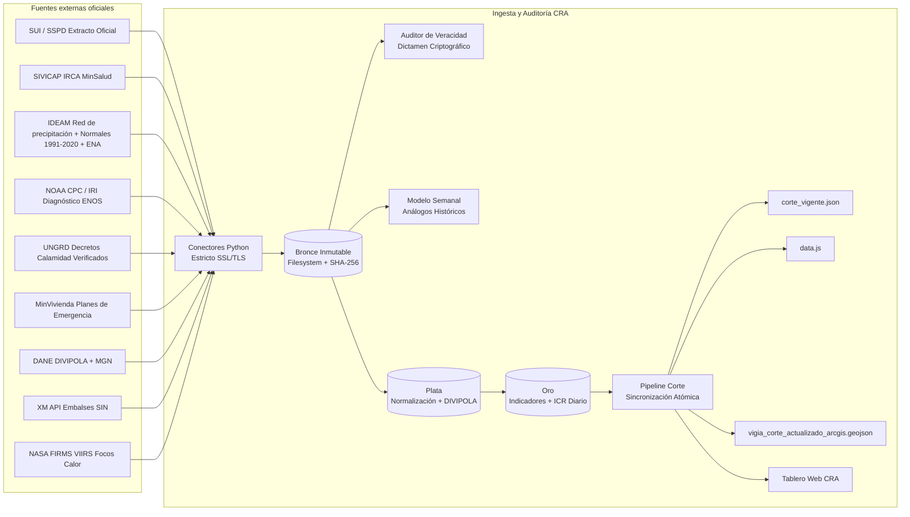

# Arquitectura — Vigía El Niño · Acueductos

Sistema analítico y regulatorio de monitoreo anticipado del impacto del Fenómeno de El Niño sobre acueductos municipales en Colombia (CRA). Implementación basada en arquitectura de tres zonas (Bronce, Plata, Oro), verificación criptográfica de veracidad y sincronización atómica de tableros.

## Vista general

## Componentes

| Componente | Responsabilidad | Tecnología | Depende de |
|---|---|---|---|
| `ingesta/conectores/` | Conectores oficiales por fuente (NOAA, SIVICAP, IDEAM, UNGRD, XM, FIRMS, SUI). Descarga cruda con verificación SSL estricta y trazabilidad a Bronce. | Python 3.12, httpx/urllib, SSL default context | Salida HTTPS a internet |
| `ingesta/conectores/conector_sui.py` | Extracción de indicadores oficiales SUI (H-4 autonomía y S-6 consumo per cápita) sin diccionarios quemados. | Python 3.12, json, pydantic | Extracto oficial SUI certificado |
| `ingesta/semanal/modelo_semanal.py` | Pipeline semanal de proyección multivariada, similitud euclidiana de análogos (2015-16, 2023-24, 2009-10) y persistencia en `AlmacenHistorico`. | Python 3.12, numpy, pandas | Series históricas Bronce (XM, IDEAM, UNGRD, FIRMS, NOAA) |
| `auditoria/auditor_veracidad.py` | Verificación criptográfica SHA-256 de todas las capturas Bronce, reconciliación punto a punto (460 puntos), validación de reglas RN-CAL y emisión de Certificado Fehaciente. | Python 3.12, hashlib, ast | Zonas Bronce, Plata y Oro |
| `ingesta/pipeline_corte.py` | Ejecución del corte oficial diario, validación de integridad y sincronización atómica concurrente (`corte_vigente.json`, `data.js`, GeoJSON ArcGIS). | Python 3.12 | Capas analíticas Oro |
| `tablero/` | Tablero de control operativo y directivo CRA (V-01 a V-04) con renderizado dinámico de diagnósticos territoriales. | HTML5, Vanilla CSS, JS ES6+, Leaflet/ArcGIS GeoJSON | Artefactos sincronizados Oro |
| `servidor_tablero.py` | Servidor HTTP local CRA para servir el tablero web y endpoints API de corte. | Python 3.12 `http.server` | Directorio `tablero/` |

## Modelo de datos

Esquemas de almacenamiento analítico:

| Esquema / Zona | Contenido | Regla |
|---|---|---|
| `data/bronce/` | Archivos crudos inmutables organizados por `fte_*` con hash SHA-256 registrado en `data/ops/capturas.json`. | Append-only inmutable. PROHIBIDO alterar o borrar archivos. |
| `data/plata/` | Datos estructurados, tipados y con llaves DIVIPOLA oficiales DANE. | Reconstruible 100% desde Bronce. |
| `data/oro/` | Tablas maestras de indicadores (`A-1` a `R-4`), subíndices de riesgo y score ICR ponderado por municipio. | Versionadas por `fecha_corte`. |
| `data/historico/` | Snapshots semanales inmutables (`YYYY-Www.json`) registrados en `data/historico/indice_historico.json`. | Generados por `AlmacenHistorico`. |
| `data/ops/` | Registros de auditoría, capturas y certificados digitales forenses. | Audit trail regulatorio inmutable. |

Entidades principales en `oro`:

| Tabla / Entidad | Llave | Descripción |
|---|---|---|
| `dim_territorio` | `divipola` | Municipio/ANM con departamento, región, geometría simplificada (MGN DANE) |
| `dim_indicador` | `codigo` (A-1…R-4) | Catálogo de los 20 indicadores oficiales de amenaza, oferta hídrica, servicio y respuesta |
| `fct_indicador_municipio` | (`fecha_corte`, `divipola`, `codigo`) | Valor numérico, unidad, valor normalizado 0-100, fuente, fecha del dato, estado de calidad |
| `fct_icr_municipio` | (`fecha_corte`, `divipola`) | ICR, subíndices por capa (A, H, S, R), nivel de alerta, piso de alerta y cobertura |
| `fct_amenaza_global` | (`fecha_corte`) | Anomalía ONI/RONI, probabilidad El Niño NOAA y estado oficial |
| `corte` | `fecha_corte` | Estado del corte diario: `publicado`, emitido atómicamente |

## Integraciones externas oficiales

| Fuente / Sistema | Endpoint / Mecanismo | Protocolo / Auth | Manejo de Fallo y Resiliencia |
|---|---|---|---|
| **XM Embalses** | `https://apielnec.xm.com.co/api/sin/capacidad-util-reservorio` | HTTPS / Ninguna | Fallback a extracto histórico en `data/bronce/fte_xm_embalses/`. Ponderación multirreservorio por capacidad útil máxima oficial. |
| **SUI SSPD** | `data/bronce/fte_sui/extracto_oficial_sui_2026.json` (Extracto oficial certificado) | Local Bronce / Certificado SSPD | Fuente primaria formal para H-4 y S-6. Error estricto si el extracto no está disponible. |
| **IDEAM** | Precipitación cada 10 min (`datos.gov.co/resource/s54a-sgyg`), normales 1991-2020 (`nsz2-kzcq`), ENA y polígonos municipales (`visualizador.ideam.gov.co/gisserver`). URLs en `data/config/parametros_ideam.json` | HTTPS / Socrata y ArcGIS REST, sin autenticación | Sin dato suficiente, el indicador queda `sin_dato`; no hay respaldo con valores fijos (el catálogo estático se retiró el 2026-11-08). |
| **UNGRD / MinVivienda** | Catálogo de actos administrativos (`data/config/actos_administrativos_verificados.json`) | Verificación de Decretos Oficiales | Exclusivamente municipios con declaratoria vigente (e.g. Uribia, Manaure) activan R-3/R-4. Cero falsas alarmas. |
| **NASA FIRMS** | API VIIRS / NRT Area API (`https://firms.modaps.eosdis.nasa.gov/api/area/csv/`) | HTTPS / MAP_KEY | Si la llave no está configurada, degrada a `None` de forma segura sin inyectar valores ficticios. |
| **NOAA CPC** | `https://www.cpc.ncep.noaa.gov/products/analysis_monitoring/enso_advisory/` | HTTPS estricto | Boletín mensual oficial y serie TAO. Probabilidad oficial del 83.0% (octubre 2026). |
| **INS SIVICAP** | `https://www.ins.gov.co/Direcciones/Vigilancia/sivicap` | HTTPS / SIVICAP Open | Registro oficial IRCA consolidado por municipio. |

## Políticas de Verificación y Seguridad

1. **Verificación SSL/TLS Obligatoria:** Todos los conectores usan el contexto seguro del sistema operativo (`ssl.create_default_context()`). Queda estrictamente prohibido desactivar la verificación de certificados (`ssl._create_unverified_context` o `verify=False`).
2. **Cero Diccionarios Quemados (CA-01):** Todo indicador municipal debe derivarse de fuentes primarias crudas en Bronce o catálogos configurables externos. PROHIBIDO almacenar matrices de datos territoriales embebidas en el código fuente.
3. **Certificación de Veracidad Continua:** Cada ciclo de publicación ejecuta el `auditor_veracidad.py`, validando el 100% de los 460 puntos de control e integridad SHA-256.

## Historial

| Fecha | Cambio | Origen |
|---|---|---|
| 2026-10-08 | Versión inicial | ADR-0003, ADR-0005 |
| 2026-10-14 | Actualización tras Auditoría Forense: Conector SUI oficial, endpoints XM/IDEAM, modelo semanal multivariable, pipeline atómico y reactivación de SSL estricto. | Auditoría Forense CRA 2026-10-14 |
| 2026-11-08 | IDEAM con mediciones reales; retiro de `catalogo_municipios_ideam.json` | Auditoría del modelo de datos, hallazgo 1 |
