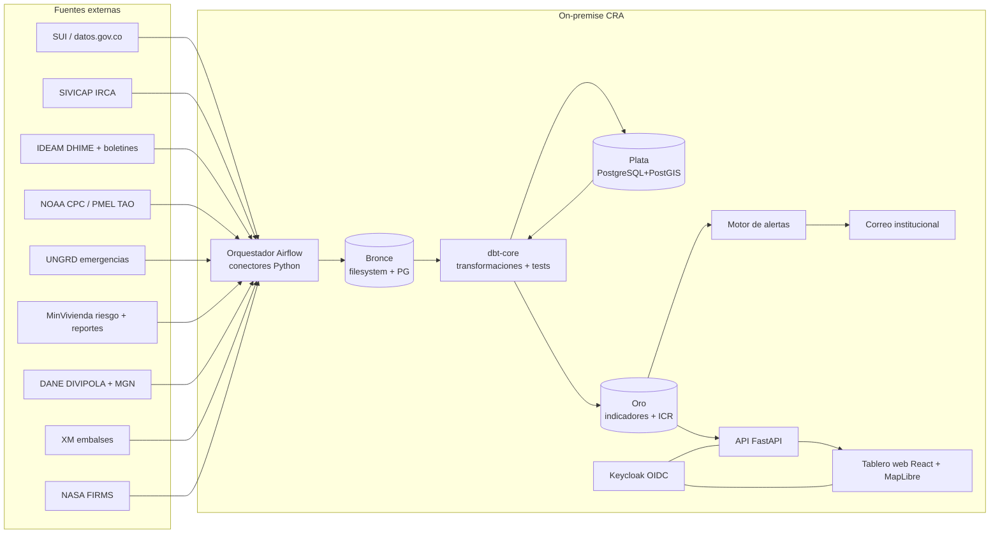

# Arquitectura — Vigía El Niño · Acueductos

Proyecto greenfield. No hay código existente. El stack está decidido a nivel de familia (ADR-0005); las versiones exactas se fijan en el primer commit y se registran en el Historial.

## Vista general

## Componentes

| Componente | Responsabilidad | Tecnología | Depende de |
|---|---|---|---|
| `ingesta/` | Un conector por fuente: descarga, guarda crudo, registra metadatos de captura | Python 3.12, httpx, pandas/polars | Red de salida a internet vía proxy CRA |
| Orquestador | Programación, reintentos, dependencias entre tareas, logs | Apache Airflow 2.x (LocalExecutor) | PostgreSQL de metadatos |
| `transform/` | Bronce → Plata → Oro; tests de calidad | dbt-core + dbt-postgres | PostgreSQL |
| Base de datos | Almacén analítico y geoespacial | PostgreSQL 16 + PostGIS 3 | — |
| `riesgo/` | Normalización de indicadores, cálculo del ICR, versionado de configuración | Python (módulo puro, sin I/O) invocado desde dbt-python o tarea Airflow | Oro |
| `alertas/` | Detección de cambios de nivel y envío | Python + SMTP | Oro, servidor de correo CRA |
| `api/` | Lectura de cortes, indicadores, fichas, exportes | FastAPI, SQLAlchemy, pydantic | PostgreSQL, Keycloak |
| `web/` | Tablero | React 18 + Vite + TypeScript, MapLibre GL JS, Apache ECharts | API |
| Identidad | Autenticación y roles | Keycloak (OIDC) federado al directorio de la CRA | Q-ARQ-01 |
| Proxy inverso | TLS, cabeceras de seguridad, estáticos | Nginx | — |
| Despliegue | Contenedores | Docker Compose en v1 | Servidor Linux CRA |

## Modelo de datos

Esquemas PostgreSQL:

| Esquema | Contenido | Regla |
|---|---|---|
| `bronce` | Una tabla por fuente con columnas crudas + `_captura_id`, `_capturado_en`, `_hash`, `_url_origen` | Append-only. NUNCA se actualiza ni borra una fila. |
| `plata` | Datos tipados y normalizados, con `divipola` resuelto | Reconstruible desde bronce |
| `oro` | Tablas de consumo | Versionadas por `fecha_corte` |
| `config` | Pesos, umbrales, catálogo de fuentes, suscripciones | Versionado: cada cambio crea fila nueva con `vigente_desde` |
| `ops` | Capturas, ejecuciones, resultados de calidad, auditoría de acceso | Append-only |

Entidades principales en `oro` (el detalle de columnas lo fija cada spec):

| Tabla | Llave | Descripción |
|---|---|---|
| `dim_territorio` | `divipola` | Municipio/ANM con departamento, región, geometría simplificada (MGN DANE) |
| `dim_prestador` | `id_prestador_rups` | Prestador de acueducto |
| `dim_indicador` | `codigo` (A-1…R-4) | Catálogo de los 20 indicadores |
| `fct_indicador_municipio` | (`fecha_corte`, `divipola`, `codigo`) | Valor, unidad, valor normalizado 0-100, fuente, fecha del dato, estado de calidad |
| `fct_icr_municipio` | (`fecha_corte`, `divipola`) | ICR, subíndices por capa, nivel de alerta, `config_version`, cobertura de datos |
| `fct_icr_departamento` | (`fecha_corte`, `cod_depto`) | Agregados departamentales |
| `fct_amenaza_global` | (`fecha_corte`) | Índices Niño, probabilidades, estado de alerta NOAA |
| `evt_alerta` | `id_alerta` | Cambios de nivel con estado de revisión |
| `corte` | `fecha_corte` | Estado del corte: `en_proceso`, `publicado`, `rechazado` |

## Integraciones externas

| Sistema | Protocolo | Autenticación | Qué pasa si está caído |
|---|---|---|---|
| datos.gov.co (Socrata) | HTTPS REST SoQL | App token opcional | Reintento 3 veces con espera exponencial; se usa último dato válido y se marca frescura |
| SUI SSPD | HTTPS descarga de reportes | Q-ING-01 | Ídem |
| NOAA CPC / PMEL | HTTPS archivos de texto | Ninguna | Ídem |
| IDEAM DHIME | HTTPS descarga | Q-ING-03 | Ídem |
| UNGRD, MinVivienda | HTTPS descarga de archivos publicados | Ninguna | Ídem |
| NASA FIRMS | HTTPS API | MAP_KEY gratuita | Ídem |
| Correo CRA | SMTP con TLS | Cuenta de servicio | Alerta queda `pendiente_envio` y se reintenta cada 15 min |

Detalle por fuente en `specs/ingesta-fuentes.md`.

## Convenciones de código

- Monorepo con carpetas `ingesta/`, `dags/`, `transform/` (proyecto dbt), `riesgo/`, `alertas/`, `api/`, `web/`, `infra/`, `context-lake/`.
- Python: `ruff` + `mypy --strict` en `riesgo/` y `alertas/`; pruebas con `pytest`. Nombres de dominio en español según `docs/glosario.md` (`divipola`, `fecha_corte`, `nivel_alerta`).
- Un conector por fuente en `ingesta/fuentes/<fuente>.py`, implementando la interfaz `Conector` (`descargar() -> Captura`). PROHIBIDO que un conector escriba en `plata` u `oro`: rompe la trazabilidad bronce→oro.
- Toda fecha se guarda en UTC (`timestamptz`) y se presenta en `America/Bogota`.
- `riesgo/` es lógica pura sin acceso a BD ni red, para poder probarla con datos sintéticos.
- PROHIBIDO hardcodear pesos, umbrales o URLs de fuentes en código: viven en `config` (ADR-0003).
- PROHIBIDO usar CDNs externos en `web/`: el tablero debe funcionar sin salida a internet desde el navegador del usuario. Fuentes tipográficas e íconos se empaquetan.
- Secretos por variables de entorno cargadas desde un `.env` fuera del repositorio.

## Deuda técnica conocida

| Dónde | Qué | Impacto para un agente que toque esta zona |
|---|---|---|
| — | Proyecto nuevo | — |

## Preguntas abiertas

| ID | Pregunta | Bloquea | Responsable |
|---|---|---|---|
| Q-ARQ-01 | ¿Directorio de identidad de la CRA: Active Directory local, Entra ID o ambos? Define la federación de Keycloak. | RF-SEG-01 | TI CRA |
| Q-ARQ-02 | ¿Capacidad del servidor asignado (vCPU, RAM, disco) y si hay entorno de pruebas separado? | Despliegue | TI CRA |
| Q-ARQ-03 | ¿El servidor tiene salida HTTPS a internet directa o por proxy con lista blanca? | Todos los conectores | TI CRA |
| Q-ARQ-04 | ¿Política de respaldos de la CRA para bases de datos? | RNF-CAL-03 | TI CRA |

## Historial

| Fecha | Cambio | Origen |
|---|---|---|
| 2026-10-08 | Versión inicial | ADR-0003, ADR-0005 |
