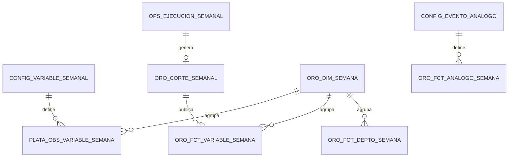

# Spec — Comparativo semanal del fenómeno El Niño en Colombia (V-08)

## Propósito

Permitir a ACT-ANALISTA comparar **semana a semana** el comportamiento real del evento El Niño 2026-27: la amenaza oceánica (NOAA CPC) y su efecto observado en Colombia (embalses, lluvia, focos de calor, ICR), contra la semana anterior y contra eventos análogos históricos. Incluye un botón para **actualizar los datos del tablero** bajo demanda.

NO cubre cálculo del ICR (ver `specs/indice-riesgo.md`) ni predicción climática (fuera de alcance).

## Contexto relevante

- Flujo: `docs/business_context.md` → FL-01 (ingesta) y FL-02 (consulta)
- Diseño: `docs/design_system.md`
- Arquitectura medallón: `adr/ADR-0003-arquitectura-medallon.md`
- Términos: Semana ISO, Semana del evento, Análogo, Arrastre (ver Glosario de esta spec)

## Glosario de la spec

| Término | Definición |
|---|---|
| Semana ISO | Semana lunes–domingo según ISO-8601, identificada como `AAAA-Www` (ej. `2026-W41`). Calculada en `America/Bogota`. |
| Semana foco | Semana que el usuario está analizando (por defecto la última semana con datos). |
| Semana de referencia | Semana contra la que se compara: la anterior (por defecto) o hace N semanas. |
| Inicio del evento | Primera semana de la racha vigente de `semanas_consecutivas_inicio` semanas con Niño 3.4 ≥ `umbral_inicio_c` (parámetros en config). |
| Semana del evento | Número de semanas transcurridas desde el inicio del evento (1 = semana de inicio). |
| Análogo | Evento El Niño histórico (ej. 1997-98, 2015-16, 2023-24) alineado por semana del evento. |
| Arrastre | Valor de una variable de publicación no semanal (ej. ONI trimestral) repetido en las semanas siguientes hasta la nueva publicación. Siempre marcado `es_arrastre = true`. |

## Requisitos funcionales

### RF-SEM-01 — Serie semanal por variable

El sistema DEBE consolidar para cada variable del catálogo `config.variable_semanal` un valor por Semana ISO, desde `semana_inicio_seguimiento` hasta la semana actual. Si en una semana no hay observación, el valor DEBE ser `null` con `estado_dato = "sin_dato"` (nunca 0).

Regla de agregación por variable (config `agregacion`): `ultimo` (última observación de la semana), `promedio`, `suma` o `arrastre` (último publicado, marcado).

**Prioridad:** debe

### RF-SEM-02 — Comparación contra semana de referencia

Para cada (semana, variable) el sistema DEBE calcular `valor_referencia`, `delta_abs`, `delta_pct` y `tendencia ∈ {empeora, mejora, estable, sin_dato}` según la dirección de la variable (`sube_empeora` / `baja_empeora`) y su `tolerancia_estable`.

```gherkin
Escenario: Niño 3.4 sube frente a la semana anterior
  Dado Niño 3.4 = 3,1 °C en 2026-W39 y 3,2 °C en 2026-W40
  Y tolerancia_estable = 0,05 °C
  Cuando se publica el comparativo de 2026-W40
  Entonces delta_abs = +0,1 °C y tendencia = "empeora"

Escenario: Semana sin dato
  Dado no hay captura XM en 2026-W38
  Entonces EMBALSES_NAL_PCT en 2026-W38 tiene valor null y estado_dato "sin_dato"
  Y la tendencia de 2026-W39 frente a 2026-W38 es "sin_dato"
```

**Prioridad:** debe

### RF-SEM-03 — Comparación con eventos análogos

El sistema DEBE alinear las variables NOAA (Niño 1+2, 3, 3.4, 4) del evento vigente con cada evento de `config.evento_analogo` por semana del evento, y mostrarlas superpuestas con las franjas de intensidad (+0,5 / +1,0 / +1,5 / +2,0 °C). Debe permitir alinear también por semana del año.

**Prioridad:** debe

### RF-SEM-04 — Comparativo departamental

El sistema DEBE mostrar por departamento el ICR medio ponderado y la población en naranja+roja de la semana foco frente a la de referencia, con el cambio y el número de municipios que cambiaron de nivel. Fuente: último corte publicado de cada semana.

**Prioridad:** debe

### RF-SEM-05 — Botón «Actualizar datos»

CUANDO ACT-ANALISTA pulsa «Actualizar datos», el sistema DEBE:

1. Rechazar la solicitud con el mensaje «Ya hay una actualización en curso» si existe una ejecución activa (máx. 1 ejecución activa, `AGENTS.md`).
2. En modo `completo`: ejecutar el ciclo FL-01 (conectores → bronce → corte oro) y luego reconstruir el modelo semanal. En modo `recalculo`: solo reconstruir el modelo semanal desde bronce y oro existentes.
3. Mostrar el progreso por paso (conector, consolidación, publicación) sin bloquear la vista.
4. Al terminar, recargar el tablero con el nuevo corte semanal y mostrar la hora de actualización; si falla, conservar el último corte publicado y mostrar el error.
5. Registrar la ejecución en `ops.ejecucion_semanal` (inicio, fin, modo, estado, pasos, hash de entradas).

```gherkin
Escenario: Actualización exitosa
  Dado el tablero muestra el corte semanal 2026-W41 generado a las 07:00
  Cuando ACT-ANALISTA pulsa "Actualizar datos"
  Entonces ve el progreso de cada fuente
  Y al finalizar el tablero muestra la nueva hora de generación sin recargar la página

Escenario: Fuente caída durante la actualización
  Dado XM no responde
  Cuando termina la actualización
  Entonces el paso XM aparece como "fallido"
  Y la semana actual de EMBALSES_NAL_PCT queda "sin_dato" si no hubo captura previa en la semana
  Y el resto del comparativo se publica
```

**Prioridad:** debe

### RF-SEM-06 — Transparencia

Toda cifra DEBE mostrar fuente y fecha del dato (al pasar el cursor o en la tarjeta). Los valores por arrastre DEBEN rotularse «último publicado». Los valores de muestra parcial (subconjunto de municipios monitoreados) DEBEN indicar el tamaño de la muestra.

**Prioridad:** debe

### RF-SEM-07 — Exportación

El sistema DEBE permitir exportar la matriz semana a semana a CSV (separador `;`, decimal `,`, UTF-8 con BOM).

**Prioridad:** debe

## Modelo de almacenamiento

Implementación v1 en archivos JSON siguiendo el medallón (`data/<zona>/semanal/`). Equivalente PostgreSQL objetivo en `transform/sql/comparativo_semanal.sql`.



| Zona | Entidad | Llave | Contenido | Archivo v1 |
|---|---|---|---|---|
| config | `variable_semanal` | (`codigo`, `vigente_desde`) | Nombre, unidad, fuente, agregación, dirección, tolerancia, umbrales | `data/config/comparativo_semanal.json` |
| config | `evento_analogo` | `id_evento` | Nombre, ventana de búsqueda, ONI pico de referencia | ídem |
| plata | `obs_variable_semana` | (`semana_iso`, `codigo`, `ambito`) | Observación agregada con fuente, fecha del dato, n.º de observaciones, archivo bronce de origen | `data/plata/semanal/obs_variable_semana.json` |
| oro | `dim_semana` | `semana_iso` | Inicio (lunes), fin (domingo), año ISO, número, semana del evento | dentro del corte |
| oro | `fct_variable_semana` | (`semana_iso`, `codigo`) | Valor, referencia, deltas, tendencia, nivel, estado del dato | dentro del corte |
| oro | `fct_analogo_semana` | (`id_evento`, `semana_evento`, `codigo`) | Valor del análogo alineado | dentro del corte |
| oro | `fct_depto_semana` | (`semana_iso`, `cod_depto`) | ICR medio, población N+R, conteo de niveles | dentro del corte |
| oro | `corte_semanal` | `semana_iso` | Metadatos, hash de entradas, versión de config | `data/oro/semanal/corte_semanal_<semana>.json` + `..._vigente.json` |
| ops | `ejecucion_semanal` | `id_ejecucion` | Bitácora append-only de actualizaciones | `data/ops/ejecuciones_semanal.json` |

Reglas: plata es reconstruible desde bronce + cortes oro diarios; el corte semanal de una semana se sobrescribe mientras la semana esté abierta y queda congelado al cerrarse.

## Requisitos no funcionales

- **RNF-SEM-01:** La reconstrucción del modelo semanal (modo `recalculo`) DEBE terminar en menos de 10 s con la serie NOAA completa (1981–hoy).
- **RNF-SEM-02:** El servidor local DEBE escuchar solo en `127.0.0.1` mientras no exista Keycloak (`specs/seguridad-acceso.md`).
- **RNF-SEM-03:** Sin CDNs externos; ECharts y tipografía locales.

## Casos borde

| Situación | Comportamiento |
|---|---|
| Servidor sin API (tablero abierto con `http.server`) | El botón muestra «La actualización requiere el servidor del tablero (iniciar_tablero.ps1)» y el tablero carga la copia estática publicada |
| No se detecta inicio de evento | Semana del evento `null`; la comparación con análogos se alinea por semana del año |
| Varias capturas en la misma semana | Se aplica la agregación de config; se informa `n_obs` |

## Asunciones

> **ASUNCIÓN (sin validar):** Umbrales de embalses (crítico < 40 %, vigilancia < 55 %) y de focos de calor parametrizados provisionalmente en config. Validar con Subdirección de Regulación.

> **ASUNCIÓN (sin validar):** Las variables IDEAM y FIRMS provienen de la muestra de municipios monitoreados por los conectores actuales, no del universo nacional.

## Preguntas abiertas

| ID | Pregunta | Bloquea | Responsable |
|---|---|---|---|
| Q-SEM-01 | ¿Qué eventos análogos oficiales usa el IDEAM para comparación (1997-98, 2015-16, 2023-24)? | RF-SEM-03 (estado validado) | Camilo / IDEAM |
| Q-SEM-02 | ¿Qué rol puede ejecutar «Actualizar datos» en modo completo? | RF-SEM-05 en producción | TI CRA |

## Historial

| Fecha | Cambio | Origen |
|---|---|---|
| 2026-10-13 | Versión inicial | Solicitud de micrositio comparativo semanal |
