# Informe de Diagnóstico Técnico y Estado del Arte: Sistema Vigía El Niño · Acueductos

**Entidad:** Comisión de Regulación de Agua Potable y Saneamiento Básico (CRA)  
**Proyecto:** Sistema de Monitoreo Integral de Riesgo en Servicios de Acueducto frente a Eventos Climáticos Extremos — Vigía El Niño · Acueductos  
**Documento:** `docs/auditoria/01_estado_del_arte_y_diagnostico.md`  
**Hito:** M1 (Requerimiento R1)  
**Versión:** 1.0.0 — Informe Definitivo de Auditoría y Estado del Arte  
**Fecha de Emisión:** 6 de noviembre de 2026  
**Clasificación:** Documento Técnico Institucional / Auditoría Interna  
**Estado:** Aprobado / Completo (Sin secciones pendientes ni placeholders)

---

## Control de Versión y Registro de Cambios

| Versión | Fecha | Autor / Rol | Descripción del Cambio / Alcance |
|---|---|---|---|
| **1.0.0** | 2026-11-06 | Subagente Especialista M1 (Implementer / QA / Specialist) | Redacción integral del informe de diagnóstico técnico, inventario del repositorio, arquitectura As-Is vs To-Be, stack tecnológico, matriz de madurez sectorial y catálogo de brechas técnicas conforme al Requerimiento R1 y el plan de auditoría. |

---

## Resumen Ejecutivo

El presente documento constituye el **Informe de Diagnóstico Técnico y Estado del Arte** del sistema **Vigía El Niño · Acueductos**, desarrollado para la Comisión de Regulación de Agua Potable y Saneamiento Básico (CRA) de la República de Colombia. El objetivo del sistema es anticipar y mitigar el impacto adverso del fenómeno hidroclimático de El Niño 2026-27 sobre la continuidad, calidad y cobertura de los servicios de acueducto en el territorio nacional.

El diagnóstico revela que el sistema cuenta con un diseño conceptual y metodológico robusto, orientado por especificaciones funcionales formales (*Specs-Driven Development* - SDD) y respaldado por una batería integral de **20 indicadores** clasificados en cuatro capas: **Amenaza hidroclimática (A)**, **Vulnerabilidad de la oferta hídrica (H)**, **Desempeño del servicio de acueducto (S)** y **Respuesta e impacto territorial (R)**, sintetizados en un **Índice Compuesto de Riesgo (ICR)** a escala municipal (código DIVIPOLA). Asimismo, el repositorio incorpora un motor de auditoría criptográfica SHA-256 (`auditor_veracidad.py`) capaz de certificar de manera fehaciente la procedencia inmutable de los datos primarios almacenados en una estructura tipo Medallón en el sistema de archivos (`data/bronce`, `data/plata`, `data/oro`, `data/ops`).

No obstante, la auditoría técnica identifica una **brecha estructural significativa entre la arquitectura documentalmente aprobada y la arquitectura efectivamente implementada en el código fuente**. Mientras que las decisiones de arquitectura formalizadas (en particular el registro de decisión `ADR-0005`) estipulan un stack de código abierto empresarial desplegado mediante contenedores Docker —compuesto por PostgreSQL 16 con extensión geoespacial PostGIS 3, Apache Airflow 2.x, dbt-core, FastAPI, React 18 con TypeScript y Keycloak—, el repositorio físico opera en realidad como un **prototipo avanzado local en Python puro**, apoyado en archivos planos JSON, un servidor monohilo de la librería estándar (`http.server.ThreadingHTTPServer` en el puerto `8088`), scripts batch/powershell para la ejecución manual y una interfaz de usuario cliente en JavaScript ES6+ Vanilla con Leaflet y Apache ECharts.

Adicionalmente, se detecta que varios conectores de ingesta externa (en particular IDEAM, UNGRD/MinVivienda y NOAA A-2) sufren de **mecanismos de degradación estática**: ejecutan consultas a APIs gubernamentales cuyos payloads son descartados para utilizar, en su lugar, catálogos locales en JSON (`catalogo_municipios_ideam.json`, `actos_administrativos_verificados.json`) o constantes numéricas quemadas (probabilidad A-2 al 83.0%). Por su parte, la ingesta del Sistema Único de Información (SUI) depende de un extracto estático precargado en la zona Bronce, al carecer de un pipeline de conexión automatizado contra la bodega de datos de la Superintendencia de Servicios Públicos Domiciliarios (SSPD). El alcance geográfico actual cubre **23 municipios prioritarios**, lo que impone un reto de escalabilidad para alcanzar los 1.122 municipios del país.

Este informe desglosa de manera exhaustiva el contexto regulatorio, el inventario completo de los 378 archivos del repositorio, la comparativa técnica de arquitecturas, el stack tecnológico detallado, una matriz de madurez frente a plataformas homologables del sector (SUI, IDEAM, SNPAD/UNGRD y SCADA de operadores) y la priorización de las brechas técnicas a resolver para transformar el sistema en una solución productiva de grado corporativo.

---

## 1. Propósito del Sistema, Marco Regulatorio de la CRA y Objetivos de Alerta Temprana

### 1.1 Contexto Hidroclimático: El Fenómeno El Niño 2026-27

Colombia enfrenta periódicamente perturbaciones extremas en su ciclo hidrológico inducidas por el ciclo El Niño-Oscilación del Sur (ENSO, por sus siglas en inglés). Durante la fase cálida (El Niño), se produce un debilitamiento anómalo de los vientos alisios del este en la cuenca del Océano Pacífico ecuatorial, lo que genera un calentamiento de las aguas superficiales que altera los patrones de circulación atmosférica global (celdas de Walker y Hadley). 

En el territorio colombiano, este fenómeno se traduce en una drástica reducción de las precipitaciones en las regiones Andina, Caribe y Pacífica, un aumento de la radiación solar y la temperatura ambiente, y un incremento sustancial de la evapotranspiración. Como consecuencia directa, los caudales de los ríos y quebradas que abastecen los sistemas de acueducto caen sensiblemente por debajo de sus medias multianuales, y los volúmenes útiles de los embalses de regulación hídrica descienden a niveles críticos.

De acuerdo con los reportes emitidos por el *Climate Prediction Center* de la Administración Nacional Oceánica y Atmosférica de los Estados Unidos (NOAA CPC) y la Universidad de Columbia (IRI), el evento El Niño 2026-27 ha mostrado una acelerada tasa de intensificación:
- En la región **Niño 3.4** (región central de referencia global, $5^\circ\text{N}-5^\circ\text{S}, 170^\circ\text{W}-120^\circ\text{W}$), la anomalía de temperatura superficial del mar (SST) superó los **+1.8 °C**.
- En la región **Niño 1+2** (aguas adyacentes a las costas de Sudamérica), las anomalías registraron picos superiores a los **+3.4 °C**.
- Los modelos predictivos determinaron una probabilidad superior al **75 %** de que el evento alcance la categoría de **histórico / muy fuerte** (Índice Oceánico de El Niño - ONI $\ge +2.5\ ^\circ\text{C}$) durante el trimestre octubre-diciembre de 2026 y el primer trimestre de 2027.

La experiencia histórica de Colombia en eventos severos previos evidencia la vulnerabilidad estructural del sector de agua potable:
- **Evento 2014-2016:** Ocasionó declaratorias de calamidad pública en 358 municipios, de las cuales 187 (el 52.2 %) tuvieron como causa directa el desabastecimiento severo de agua potable, afectando a más de 296 municipios con medidas de racionamiento forzoso y suministro por carrotanques (según reportes consolidados en la Circular MinVivienda 2026EE0026348).
- **Evento 2023-2024:** Condujo a niveles históricamente bajos en el Sistema Chingaza (por debajo del 16 % de capacidad útil), obligando a Bogotá D.C. y a más de 10 municipios de la Sabana a implementar esquemas de racionamiento por turnos durante varios meses.

Para el evento 2026-27, el Ministerio de Vivienda, Ciudad y Territorio (MinVivienda) identificó preliminarmente un universo crítico de **558 municipios y áreas no municipalizadas en riesgo**: **111 en riesgo Muy Alto** y **447 en riesgo Alto**, demandando una acción coordinada, preventiva y científicamente informada por parte de las entidades rectoras del sector.

---

### 1.2 Marco Jurídico y Competencias Regulatorias de la CRA

La **Comisión de Regulación de Agua Potable y Saneamiento Básico (CRA)** es una Unidad Administrativa Especial del orden nacional con personería jurídica, autonomía técnica, administrativa y patrimonial, adscrita al Ministerio de Vivienda, Ciudad y Territorio. Sus competencias regulatorias y su papel frente a eventos de variabilidad climática se sustentan en el siguiente ordenamiento jurídico:

```
┌────────────────────────────────────────────────────────────────────────────────────────┐
│                        MARCO NORMATIVO Y REGULATORIO APLICABLE                         │
└────────────────────────────────────────────────────────────────────────────────────────┘
  LEY 142 DE 1994          ──► Marco General de Servicios Públicos Domiciliarios
                               (Arts. 73 y 74: Competencias de la CRA; Art. 2: Garantía
                               de calidad, cobertura y continuidad; Art. 87: Eficiencia)
                                     │
                                     ▼
  RESOLUCIÓN CRA 943/2021  ──► Resolución Única Regulatoria del Sector de Agua y Saneamiento
                               (Compila marcos tarifarios Res. CRA 688/2014, 825/2017;
                               mecanismos de modificación tarifaria por caso fortuito/fuerza mayor)
                                     │
                                     ▼
  RESOLUCIÓN CRA 887/2019  ──► Desincentivo al Consumo Excesivo de Agua Potable
                               (Compilada en Res. CRA 943/2021, Libro 2, Parte 4, Título 2;
                               penalización por m³ que supere el consumo básico; recaudo al FONAM)
                                     │
                                     ▼
  DECRETO 1077 DE 2015     ──► Planes de Emergencia y Contingencia (PEC)
                               (Art. 2.3.4.1.1 y ss., Res. MVCT 154/2014; formulación,
                               actualización y obligatoriedad ante eventos de sequía y desabastecimiento)
                                     │
                                     ▼
  LEY 1523 DE 2012         ──► Sistema Nacional de Gestión del Riesgo de Desastres (SNGRD)
                               (Declaratorias de Calamidad Pública municipal/departamental,
                               artículos 57 a 65; activación de asistencia humanitaria y subsidios)
                                     │
                                     ▼
  NORMAS COMPLEMENTARIAS   ──► Res. MinSalud 2115/2007 (Calidad del agua IRCA, Art. 13)
                               Res. SSPD 20241000395385 (Reporte diario de embalses de acueducto)
```

#### A. Ley 142 de 1994 (Régimen de Servicios Públicos Domiciliarios)
- **Artículos 73 y 74:** Facultan a la CRA para regular los monopolios en la prestación de los servicios de acueducto, alcantarillado y aseo, promover la competencia, garantizar la eficiencia económica y la suficiencia financiera de las empresas prestadoras, e impedir abusos de posición dominante.
- **Artículo 2 (Intervención del Estado):** Consagra los fines del Estado en los servicios públicos, destacando la garantía de la prestación continua, ininterrumpida y con calidad del servicio de acueducto.
- **Artículo 87 (Criterios Tarifarios):** Dispone que el régimen tarifario debe basarse en criterios de suficiencia financiera, eficiencia económica, neutralidad, solidaridad y redistribución, simplicidad y transparencia.
- **Artículo 125:** Regula la actualización de tarifas y permite la modificación extraordinaria de fórmulas tarifarias ante circunstancias excepcionales y sobrevinientes de fuerza mayor o caso fortuito.

#### B. Resolución CRA 943 de 2021 (Resolución Única Regulatoria)
Compila de manera sistemática toda la regulación de carácter general emitida por la CRA para los servicios públicos de acueducto, alcantarillado y aseo:
- Integra las metodologías tarifarias para grandes prestadores (Resolución CRA 688 de 2014 modificada por la CRA 735 de 2015) y para prestadores en esquemas de menor escala (Resolución CRA 825 de 2017 y CRA 834 de 2017).
- Regula las inversiones obligatorias en el Plan de Obras e Inversiones Regulado (POIR) orientadas a la resiliencia de las redes y a la reducción del Índice de Agua No Contabilizada (IANC).
- En el **Título 2 de la Parte 4 del Libro 2**, compila las medidas de regulación económica aplicables en situaciones de sequía, estiaje severo y variabilidad climática extrema.

#### C. Medidas de Desincentivo al Consumo Excesivo de Agua Potable (Resolución CRA 887 de 2019)
Constituye el instrumento regulatorio por excelencia de la CRA para inducir un uso racional y eficiente del agua potable ante la inminencia o presencia del fenómeno de El Niño:
- **Mecanismo Económico:** Impone un cobro coactivo adicional (desincentivo tarifario) a los suscriptores residenciales por cada metro cúbico ($m^3$) facturado que exceda el nivel de **Consumo Básico** mensual.
- **Topes de Consumo Básico por Piso Térmico:**
  - *Piso Térmico Cálido* (altitud inferior a 1.000 m.s.n.m.): $16\ m^3/\text{suscriptor}/\text{mes}$.
  - *Piso Térmico Templado* (altitud entre 1.000 y 2.000 m.s.n.m.): $14\ m^3/\text{suscriptor}/\text{mes}$.
  - *Piso Térmico Frío* (altitud superior a 2.000 m.s.n.m.): $11\ m^3/\text{suscriptor}/\text{mes}$.
- **Destinación de los Recursos:** Los valores recaudados por concepto de desincentivo no constituyen ingreso para las empresas prestadoras de acueducto, sino que deben ser transferidos obligatoriamente al **Fondo Nacional Ambiental (FONAM)** del Ministerio de Ambiente y Desarrollo Sostenible (MADS), para destinarse a la protección, reforestación y conservación de las cuencas hidrográficas abastecedoras.
- **Activación Regulatoria:** La CRA activa o desactiva la aplicación del desincentivo de manera focalizada territorialmente o a nivel nacional, tomando como insumo técnico vinculante los informes técnicos del IDEAM sobre el índice de sequía y los niveles de los embalses y cuencas. El sistema **Vigía El Niño** provee la base analítica para focalizar geográficamente estas declaratorias.

#### D. Decreto 1077 de 2015 y Resolución MVCT 154 de 2014 (Planes de Emergencia y Contingencia - PEC)
- Obliga a todas las personas prestadoras de los servicios públicos de acueducto y alcantarillado en el territorio nacional a formular, implementar, actualizar y reportar su **Plan de Emergencia y Contingencia (PEC)** para responder ante situaciones de desastre o variabilidad climática extrema (artículo 2.3.4.1.1 y subsiguientes del Decreto 1077/2015).
- Los prestadores deben registrar la radicación de sus PEC ante la Superintendencia de Servicios Públicos Domiciliarios (SSPD) a través del SUI y remitir copias a los Consejos Municipales de Gestión del Riesgo de Desastres (CMGRD). El indicador **R-1** del sistema Vigía fiscaliza este cumplimiento.

#### E. Ley 1523 de 2012 (Sistema Nacional de Gestión del Riesgo de Desastres - SNGRD)
- Establece los principios, estructura y marco operativo para la gestión del riesgo en Colombia.
- En sus artículos 57 a 65, norma el procedimiento para que los Alcaldes Municipales o Gobernadores Departamentales, previo concepto favorable de sus respectivos comités de gestión del riesgo, expidan decretos de **Declaratoria de Calamidad Pública**.
- Dicha declaratoria habilita la movilización urgente de recursos del Fondo Nacional de Gestión del Riesgo de Desastres (FNGRD), la contratación expedita de suministros alternos (carrotanques, plantas potabilizadoras móviles) y la articulación con MinVivienda y UNGRD. Los indicadores **R-2**, **R-3** y **R-4** del sistema capturan directamente el estado de estas declaraciones.

#### F. Resoluciones Conexas de Calidad y Monitoreo Operativo
- **Resolución MinProtección Social / MADS 2115 de 2007:** Define los parámetros y características microbiológicas y fisicoquímicas del agua para consumo humano, estableciendo el **Índice de Riesgo de la Calidad del Agua para Consumo Humano (IRCA)** y categorizando el riesgo sanitario:
  - $0.0\% - 5.0\%$: Sin Riesgo (Agua Apta).
  - $5.1\% - 14.0\%$: Riesgo Bajo.
  - $14.1\% - 35.0\%$: Riesgo Medio.
  - $35.1\% - 80.0\%$: Riesgo Alto.
  - $80.1\% - 100.0\%$: Inviable Sanitariamente.
  Este índice constituye la base estricta del indicador **S-2**.
- **Resolución SSPD 20241000395385:** Establece la obligatoriedad permanente para todos los prestadores del servicio de acueducto que operen embalses o represas superficiales de realizar un reporte diario antes de las 11:59 p.m. sobre su cota, volumen útil y porcentaje de llenado, transición técnica que sienta las bases para la ingesta del indicador **H-5**.

---

### 1.3 Propósito y Objetivos de Alerta Temprana del Sistema Vigía

Frente a la dispersión de datos gubernamentales y el esquema tradicional de seguimiento reactivo —basado en consolidaciones manuales en hojas de cálculo ejecutadas quincenalmente con rezagos superiores a 20 días—, la CRA concibió el proyecto **Vigía El Niño · Acueductos** con los siguientes objetivos estratégicos:

```
┌────────────────────────────────────────────────────────────────────────────────────────┐
│             TRANSICIÓN DEL MODELO REACTIVO AL MODELO ANTICIPATORIO VIGÍA               │
└────────────────────────────────────────────────────────────────────────────────────────┘
  MODELO ANTERIOR (Artesanal y Reactivo)        SISTEMA VIGÍA (Automatizado y Anticipatorio)
  ──────────────────────────────────────        ────────────────────────────────────────────
  • Consolidación manual en Excel / 15-30 días  • Ingesta automatizada y diaria de 12 fuentes
  • Seguimiento post-impacto (tras racionamiento) • Alerta temprana con anticipación ≥ 14 días
  • Datos dispersos sin homologación espacial   • Modelo territorial unificado por DIVIPOLA (5 d)
  • Criterios subjetivos por mesa técnica       • Índice Compuesto de Riesgo (ICR) reproducible
  • Trazabilidad vulnerable a error humano      • Trazabilidad criptográfica SHA-256 en Bronce
```

1. **Anticipación Proactiva ($\ge 14$ días):** Generar alertas tempranas automáticas en municipios vulnerables con al menos **14 días de antelación** respecto a la fecha en que se registre el primer reporte oficial de afectación territorial severa (declaratoria de racionamiento por prestador o decreto de calamidad pública municipal).
2. **Federación Analítica Multi-Fuente:** Consolidar e integrar bajo el código DIVIPOLA municipal del DANE un ecosistema de al menos 12 fuentes de datos gubernamentales e hidrometeorológicas:
   - *Clima global y regional:* NOAA CPC (anomalías SST, ONI) y NASA FIRMS (focos de calor térmicos).
   - *Hidrología y oferta hídrica:* IDEAM (precipitaciones diarias, caudales, Estudio Nacional del Agua - ENA) y XM Sinergox (volúmenes de embalses).
   - *Servicio de acueducto:* SUI de la SSPD (continuidad, cobertura, agua no contabilizada IANC, PQR, consumo) e INS SIVICAP (calidad del agua IRCA).
   - *Impacto y respuesta institucional:* MinVivienda (reportes de desabastecimiento Survey123) y UNGRD (calamidades públicas y carrotanques).
3. **Estandarización Cuantitativa mediante el ICR:** Calcular diariamente para cada municipio el **Índice Compuesto de Riesgo (ICR)** en una escala normalizada de $0$ a $100$ puntos, estructurado en cuatro capas temáticas:
   $$\text{ICR} = 0.30 \cdot I_A + 0.30 \cdot I_H + 0.25 \cdot I_S + 0.15 \cdot I_R$$
   con asignación estricta de bandas de alerta:
   - $\text{ICR} < 40.0$: **Sin Alerta** (Verde / Normalidad).
   - $40.0 \le \text{ICR} < 60.0$: **Alerta Amarilla** (Monitoreo Preventivo).
   - $60.0 \le \text{ICR} < 75.0$: **Alerta Naranja** (Riesgo Alto / Activación Operativa).
   - $\text{ICR} \ge 75.0$: **Alerta Roja** (Emergencia Inminente / Crisis).
4. **Regla de Piso por Impacto Confirmado (RF-ICR-06):** Si un municipio presenta formalmente un reporte activo de racionamiento/desabastecimiento ($R\text{-}3 = 1$) o una declaratoria vigente de calamidad pública ($R\text{-}4 = 1$), su nivel de alerta se eleva automáticamente a un mínimo de **Alerta Naranja**, independientemente de que la ponderación matemática de sus variables hidrológicas o de servicio resulte numéricamente inferior.
5. **Soporte Fáctico a Decisiones Regulatorias Vinculantes:** Proveer a los Comisionados y analistas técnicos de la CRA evidencia cuantitativa fehaciente, auditable e inmutable para:
   - Activar territorialmente los factores de desincentivo tarifario al consumo excesivo bajo la Resolución CRA 887/2019.
   - Requerir a los prestadores la puesta en marcha inmediata de sus Planes de Emergencia y Contingencia (PEC).
   - Evaluar solicitudes de ajuste tarifario extraordinario por costos de operación en emergencia (pozos profundos, aducciones temporales, carrotanques).
   - Respaldar la posición regulatoria de la CRA en la Sala de Crisis Nacional de la UNGRD y en la Comisión Asesora para la Coordinación y Seguimiento de la Situación Energética y de Servicios Públicos.

---

## 2. Inventario Exhaustivo de Componentes y Estructura Real del Repositorio

### 2.1 Visión General de la Estructura de Directorios

Se realizó un escaneo automatizado y minucioso de la estructura completa del repositorio en el entorno de trabajo `g:\Mi unidad\03_Carrera_MBA_y_Consultoria\Proyectos\vigia-nino-acueductos`. Descontando los metadatos de control de versiones y entornos efímeros (`.git/`, `.agents/`, `.pytest_cache/`, `__pycache__/`), el repositorio cuenta con un total de **378 archivos físicos**, ocupando aproximadamente **24.5 MB** en disco, distribuidos según el siguiente desglose:

```
vigia-nino-acueductos/
├── context-lake/             # 21 archivos (~250 KB) — Especificaciones SDD y ADRs formales
│   ├── adr/                  # 5 ADRs (ADR-0001 a ADR-0005)
│   ├── specs/                # 9 Especificaciones técnicas de negocio e ingeniería
│   ├── docs/                 # Documentos de arquitectura, glosario y auditoría forense previa
│   └── AGENTS.md             # Instrucciones operativas y definición de comandos
├── documentacion/            # 6 archivos (~42 KB) — Entregables ejecutivos y guías de fuentes
│   ├── entregables/          # Evaluaciones de datos reales, auditoría de veracidad y flujos ArcGIS
│   └── fuentes/              # Mapa de datos de embalses y catálogo de fuentes oficiales
├── ingesta/                  # 33 archivos (~185 KB) — Código Python de ingesta, modelo y riesgo
│   ├── conectores/           # 8 Conectores de fuentes oficiales + ConectorBase
│   ├── semanal/              # Modelo multivariado y almacén de series históricas
│   ├── queries_sui/          # 6 Consultas SQL para la bodega de datos Oracle SUI
│   ├── tests/                # 5 Suites de pruebas unitarias y de integración
│   ├── pipeline_corte.py     # Motor central de cálculo del ICR diario
│   ├── orquestador.py        # Orquestador secuencial de ejecución de tareas
│   ├── cli.py                # Interfaz de línea de comandos del sistema
│   └── requirements.txt      # Manifiesto básico de dependencias de Python
├── data/                     # 305 archivos (~21.6 MB) — Almacén analítico en filesystem (Medallón)
│   ├── bronce/               # 276 archivos crudos inmutables con metadatos de captura
│   ├── plata/                # 1 archivo intermedio normalizado (obs_variable_semana.json)
│   ├── oro/                  # 10 cortes analíticos finales (corte_vigente.json, cortes fechados)
│   ├── ops/                  # 24 registros operacionales (capturas.json, ejecuciones.json)
│   └── config/               # 3 catálogos de referencia (municipios, actos, pesos)
├── tablero/                  # 25 archivos (~2.5 MB) — Frontend web Vanilla HTML5/CSS3/JS
│   ├── css/                  # Hojas de estilo institucional CRA (tokens, layout, vistas)
│   ├── js/                   # Controladores JS (app.js, aula.js, data.js, storytelling.js)
│   ├── semanal/              # Sub-sitio interactivo de análisis comparativo semanal
│   ├── auditoria/            # Visualizador web del informe de veracidad
│   ├── index.html            # SPA principal del Tablero Vigía
│   └── vigia_corte_actualizado_arcgis.geojson # Capa geoespacial para consumo SIG
├── auditoria/                # 7 archivos (~120 KB) — Motor de verificación criptográfica
│   ├── auditor_veracidad.py  # Script de auditoría forense y certificación SHA-256
│   ├── index.html            # Interfaz de consulta del dictamen de veracidad
│   └── reporte_auditoria_vigente.json # Dictamen firmado con veredicto de veracidad
├── transform/                # 1 archivo (~7 KB) — DDL SQL para PostgreSQL
│   └── sql/comparativo_semanal.sql # Definición de tablas para esquema semanal
└── [Archivos de Raíz]        # 6 archivos (~11 KB) — Servidor HTTP, scripts de inicio y .gitignore
    ├── servidor_tablero.py   # Servidor HTTP local en Python estándar (puerto 8088)
    ├── iniciar_tablero.bat   # Script Batch para inicio rápido en Windows
    ├── iniciar_tablero.ps1   # Script PowerShell para inicio rápido
    ├── corregir_y_verificar.ps1 # Script de remediación de entorno
    └── .gitignore            # Exclusiones de control de versiones
```

---

### 2.2 Desglose Exhaustivo Módulo por Módulo

#### A. Módulo Raíz y Scripts de Automatización Local
1. `servidor_tablero.py` (153 líneas):
   - Implementado mediante `http.server.ThreadingHTTPServer` y `http.server.SimpleHTTPRequestHandler` de la biblioteca estándar de Python 3.
   - Escucha de forma predeterminada en el socket `127.0.0.1:8088`.
   - Implementa un enrutamiento básico que sirve archivos estáticos desde el directorio `tablero/` y maneja tres rutas API REST:
     - `GET /api/semanal/datos`: Retorna el payload JSON consolidado en `data/oro/semanal/corte_semanal_vigente.json`.
     - `GET /api/semanal/estado`: Devuelve el estado en memoria de la última ejecución (`EstadoActualizacion`: estado, progreso, mensaje, timestamp).
     - `POST /api/semanal/actualizar`: Dispara una tarea asíncrona en un hilo (`threading.Thread`) para ejecutar `ModeloSemanal().construir()` en modo `"completo"` o `"recalculo"`.
   - *Evaluación Crítica:* No implementa autenticación, cifrado SSL/TLS, control de tasa (*rate limiting*) ni persistencia de estado de tareas ante reinicios.
2. `iniciar_tablero.bat` e `iniciar_tablero.ps1`:
   - Automatizan la comprobación del intérprete de Python, instalan dependencias desde `ingesta/requirements.txt`, verifican la presencia del corte vigente y lanzan `servidor_tablero.py` abriendo el navegador en `http://localhost:8088`.

#### B. Módulo de Especificaciones Formales (`context-lake/`)
Implementa la metodología *Specs-Driven Development* (ADR-0001):
- `adr/`: Contiene 5 registros de decisión arquitectónica:
  - `ADR-0001`: Adopción del marco SDD y repositorio de especificaciones estructuradas.
  - `ADR-0002`: Adopción del código DIVIPOLA municipal del DANE (5 caracteres) como llave primaria territorial universal.
  - `ADR-0003`: Arquitectura de datos por capas Medallón (Bronce, Plata, Oro).
  - `ADR-0004`: Lineamientos de diseño e identidad institucional de la CRA (colores primarios `#43B2D7`, `#0D2C4D`, tipografía Nunito Sans).
  - `ADR-0005`: Stack de código abierto desplegado on-premise en infraestructura de la CRA (Python, Airflow, PostgreSQL/PostGIS, dbt, FastAPI, React/TypeScript/Vite, Docker).
- `specs/`: Contiene 9 especificaciones técnicas con escenarios en sintaxis Gherkin (`ingesta-fuentes.md`, `calidad-datos.md`, `modelo-territorial.md`, `indicadores.md`, `indice-riesgo.md`, `alertas.md`, `tablero-ui.md`, `seguridad-acceso.md`, `comparativo-semanal.md`).
- `docs/`: Documentos de contexto de negocio, glosario, arquitectura conceptual e informes de auditorías forenses previas.

#### C. Capa de Ingesta y Conectores Oficiales (`ingesta/conectores/`)
Comprende los adaptadores para la extracción de información desde fuentes primarias:
1. `conector_base.py` (160 líneas):
   - Clase abstracta base `ConectorBase` que obliga a implementar el método `ejecutar()`.
   - Maneja la creación estructurada de directorios en `data/bronce/<fte_id>/`.
   - Registra de forma inmutable cada descarga en `data/ops/capturas.json` generando el hash criptográfico SHA-256 del contenido crudo.
   - Configura el contexto SSL estricto: `self.ssl_context = ssl.create_default_context()`.
2. `conector_noaa.py` (140 líneas):
   - Realiza solicitudes HTTP directas contra los servidores de NOAA CPC para descargar `wksst9120.for` (anomalías semanales Niño 1+2, 3, 3.4, 4) y `oni.ascii.txt` (ONI trimestral) para el indicador A-1.
   - *Brecha Crítica Identificada:* En las líneas 126-127, el indicador A-2 (Probabilidad evento muy fuerte) está fijado de forma cableada en un valor constante: `probabilidad_muy_fuerte = 83.0` con fecha fija `"2026-10-10"`, sin consumir el feed probabilístico de IRI/CPC.
3. `conector_sivicap.py` (105 líneas):
   - Consulta la API Socrata en `datos.gov.co` (dataset `nxt2-39c3`) del Instituto Nacional de Salud.
   - Filtra mediante consultas SoQL por año (`a_o = '2024'`).
   - Normaliza el indicador S-2 (IRCA mensual municipal).
4. `conector_xm_embalses.py` (260 líneas):
   - Consulta el endpoint REST en vivo de XM Sinergox (`https://servapibi.xm.com.co/daily`) solicitando la métrica `PorcVoluUtilDiar` para los embalses del Sistema Interconectado Nacional.
   - Incorpora fallback robusto a series históricas en `data/bronce/fte_xm_historico/`.
   - Mapea el indicador municipal H-5 calculando el **promedio ponderado por capacidad nominal útil** ($Hm^3$) de los embalses que abastecen cada cabecera según el catálogo `CATALOGO_EMBALSES` (corrigiendo el promedio aritmético simple previamente detectado como bug en la auditoría del 14-oct-2026).
5. `conector_ideam.py` (145 líneas):
   - Diseñado para consultar estaciones meteorológicas en Socrata `s54a-sgyg`.
   - *Brecha Crítica Identificada:* En la línea 139, invoca `self._consultar_estaciones_socrata()`, pero el payload retornado no es consumido para los cálculos; en su lugar, el conector extrae los datos de precipitación y caudales del archivo local `data/config/catalogo_municipios_ideam.json` para los 23 municipios.
6. `conector_ungrd_minvivienda.py` (115 líneas):
   - Realiza una consulta al dataset Socrata `2343-nuqp`.
   - *Brecha Crítica Identificada:* Descarta el resultado de la consulta web y asigna los indicadores R-2, R-3 y R-4 a partir de un archivo de auditoría local `data/config/actos_administrativos_verificados.json`, en el cual **únicamente los municipios de Uribia (44847) y Manaure (44560)** registran declaratoria activa de calamidad y racionamiento; los restantes 21 municipios reciben valor cero por defecto.
7. `conector_nasa_firms.py` (110 líneas):
   - Extrae detecciones térmicas satelitales (sensores VIIRS/MODIS) para el indicador A-5.
   - Requiere la clave de API `FIRMS_MAP_KEY` en el entorno. Si no existe, degrada elegantemente a `None` (`sin_dato`) sin inventar focos de calor ni arrojar excepciones no controladas.
8. `conector_sui.py` (110 líneas):
   - Conector offline incorporado en la refactorización forense `15a2b69`. Lee extractos oficiales certificados almacenados en `data/bronce/fte_sui/` para normalizar los indicadores S-1 (continuidad), S-3 (cobertura), S-4 (IANC), S-5 (PQR), S-6 (consumo) y H-4 (autonomía de almacenamiento). Carece de conexión directa a la base de datos de la SSPD.

#### D. Motores de Procesamiento y Modelado Analítico
1. `ingesta/pipeline_corte.py` (520 líneas):
   - Motor matemático central del sistema. Procesa la cohorte de los **23 municipios piloto** (`MUNICIPIOS_MAESTRO`, líneas 178-223).
   - Implementa la normalización continua y lineal por tramos de cada indicador cuantitativo a la escala $0-100$ puntos según los puntos de quiebre definidos en la especificación (`specs/indicadores.md`).
   - Aplica los pesos de capa regulados: Capa A (30 %), Capa H (30 %), Capa S (25 %) y Capa R (15 %).
   - Aplica la regla especial del subíndice R: toma el valor máximo disponible en lugar del promedio ($I_R = \max(R_1, R_2, R_3, R_4)$).
   - Evalúa la cobertura de datos: si las variables disponibles suman al menos el 60 % del peso total, redistribuye proporcionalmente el peso faltante entre las capas con datos válidos; en caso contrario, marca el ICR municipal como `sin_dato`.
   - Aplica la **Regla de Piso por Impacto Confirmado (RF-ICR-06)**: eleva el nivel a mínimo **Naranja** si $R\text{-}3 = 1$ o $R\text{-}4 = 1$.
   - **Sincronización Atómica Multi-Destino:** Genera de forma coordinada tres artefactos idénticos:
     - `data/oro/corte_vigente.json` y `data/oro/corte_YYYY-MM-DD.json` (almacén estructurado).
     - `tablero/js/data.js` (payload JS exportado como variable global `window.VIGIA_DATA` para el frontend).
     - `tablero/vigia_corte_actualizado_arcgis.geojson` (geometrías vectoriales municipales con atributos ICR para consumo en ArcGIS o visores geográficos corporativos).
2. `ingesta/semanal/modelo_semanal.py` (620 líneas):
   - Motor analítico multivariado para análisis longitudinal y detección de patrones análogos históricos ENSO.
   - Integra series semanales de diversas fuentes (`noaa_semanal`, `noaa_oni`, `bronce_xm`, `bronce_ideam`, `bronce_firms`, `oro_corte`).
   - Calcula distancias euclidianas multivariadas entre las trayectorias del evento actual 2026-27 y los eventos históricos de referencia (2015-16, 2023-24 y 2009-10).
   - Persiste la evolución temporal en `data/plata/obs_variable_semana.json` y `data/oro/semanal/corte_semanal_vigente.json`.

#### E. Módulo de Verificación Criptográfica y Auditoría Forense (`auditoria/`)
- `auditoria/auditor_veracidad.py` (480 líneas):
  - Motor de auditoría independiente que evalúa el estado del repositorio en cinco fases consecutivas:
    - *Fase 0 (Anti-Tautología):* Inspecciona el código fuente de los conectores para garantizar que no existen diccionarios sintéticos ni valores inventados embebidos en memoria.
    - *Fase 1 (Integridad Criptográfica de Bronce):* Verifica que cada archivo crudo registrado en `data/ops/capturas.json` exista físicamente en disco y que su hash SHA-256 coincida exactamente con el calculado al momento de la captura.
    - *Fase 2 (Reconciliación 1:1 Celda a Celda):* Cruza los 460 puntos de control del sistema (23 municipios $\times$ 20 indicadores) entre los valores crudos presentes en la zona Bronce y los publicados en la zona Oro (`data/oro/corte_vigente.json`), admitiendo una tolerancia matemática inferior a $10^{-4}$.
    - *Fase 3 (Recálculo Matemático Autónomo):* Recalcula desde cero las fórmulas del ICR, la redistribución de pesos y la aplicación de reglas de piso para verificar que no hubo manipulación de las alertas.
    - *Fase 4 (Reglas de Calidad Física):* Comprueba límites de rango físico (RN-CAL-01 a RN-CAL-07), por ejemplo: $0 \le \text{IRCA} \le 100$, continuidad entre 0 y 24 h/día, caudales no negativos.
  - Genera el reporte oficial de certificación: `auditoria/reporte_auditoria_vigente.json` y su versión web `auditoria/auditoria_data.js`.

#### F. Capa de Presentación Web Institucional (`tablero/`)
- Construido como una Single Page Application (SPA) responsive en **HTML5 semántico, CSS3 modular y JavaScript ES6+ Vanilla**.
- Incorpora las bibliotecas de visualización descargadas localmente en su código (no depende de CDNs ni conexiones a internet en tiempo de ejecución):
  - **Leaflet 1.9.4** (`leaflet.js`, `leaflet.css`): Motor de mapas interactivos que renderiza los polígonos municipales y la simbología temática de alertas (verde, amarillo, naranja, rojo).
  - **Apache ECharts 5.x** (`echarts.min.js`): Motor de gráficos interactivos de alto rendimiento para diagramas de dispersión, series temporales, velocímetros de nivel de riesgo y gráficos de radar.
- Desarrollado bajo los tokens de diseño institucional de la CRA:
  - Color primario turquesa: `#43B2D7`.
  - Azul marino institucional: `#0D2C4D`.
  - Tipografía corporativa: Nunito Sans (Google Fonts con respaldo local).
- Vistas implementadas en `index.html` y `tablero/js/app.js`:
  - `V-01`: Resumen Ejecutivo Nacional y KPIs macroclimáticos.
  - `V-02`: Amenaza Hidroclimática (anomalías SST, precipitación, focos térmicos FIRMS).
  - `V-03`: Vulnerabilidad y Oferta Hídrica (caudales IDEAM, embalses XM H-5, índices ENA).
  - `V-04`: Desempeño del Servicio de Acueducto (continuidad S-1, calidad IRCA S-2, pérdidas IANC S-4).
  - `V-05`: Matriz de Riesgo Territorial e Índice Compuesto de Riesgo (ICR por municipio y ficha técnica).
  - `V-06`: Bandeja de Escalamientos y Gestión de Alertas tempranas para Comisionados.
  - `V-07`: Monitor Operativo de Fuentes, Ingesta y Auditoría Forense.
  - `STORY`: Recorrido narrativo guiado en cinco actos para presentación directiva.
  - `AULA`: Módulo pedagógico interactivo ("Aula El Niño", controlado por `tablero/js/aula.js`) para capacitar a prestadores y analistas sobre la dinámica del fenómeno.
- Sub-aplicación `tablero/semanal/`:
  - Interfaz especializada en el seguimiento de curvas longitudinales, contraste con eventos análogos (2015-16 / 2023-24) y control de disparo de recálculos vía API REST local.

---

### 2.3 Matriz de Archivos Clave del Repositorio

| Archivo | Módulo | Líneas Aprox. | Propósito Técnico Principal | Estado Operativo |
|---|---|---|---|---|
| `servidor_tablero.py` | Raíz | 153 | Servidor HTTP local multi-hilo (`http.server`), rutas `/api/semanal/*` y estáticos. | Funcional local (monousuario). |
| `ingesta/requirements.txt` | Ingesta | 7 | Lista de 6 dependencias básicas (`httpx`, `requests`, `pydantic`, `pytest`, `pyyaml`, `openpyxl`). | Mínimo; falta lockfile y empaquetado. |
| `ingesta/conectores/conector_base.py` | Ingesta | 160 | Clase base con gestión de capturas Bronce, hash SHA-256 y contexto SSL estricto. | Funcional y auditable. |
| `ingesta/conectores/conector_noaa.py` | Ingesta | 140 | Descarga de índices SST y ONI; indicador A-2 fijado al 83.0 %. | Híbrido (A-1 vivo, A-2 fijo). |
| `ingesta/conectores/conector_xm_embalses.py` | Ingesta | 260 | Consulta API REST Sinergox XM; ponderación por capacidad nominal de embalses H-5. | Funcional en vivo con fallback. |
| `ingesta/conectores/conector_sivicap.py` | Ingesta | 105 | Consulta SoQL Socrata INS para indicador S-2 (IRCA municipal). | Funcional (filtra año 2024). |
| `ingesta/conectores/conector_ideam.py` | Ingesta | 145 | Descarga Socrata de estaciones IDEAM; extrae datos de JSON local. | Degradado a catálogo local. |
| `ingesta/conectores/conector_ungrd_minvivienda.py` | Ingesta | 115 | Asigna indicadores R-2, R-3 y R-4 desde catálogo de actos verificados. | Degradado a catálogo local (2 mun). |
| `ingesta/conectores/conector_nasa_firms.py` | Ingesta | 110 | Ingesta API VIIRS/MODIS; degradación segura a `None` ante ausencia de API key. | Funcional condicional. |
| `ingesta/conectores/conector_sui.py` | Ingesta | 110 | Normaliza indicadores S-1, S-3, S-4, S-5, S-6 y H-4 desde extractos locales certificados. | Funcional offline (sin conexión Oracle). |
| `ingesta/pipeline_corte.py` | Ingesta | 520 | Motor de cálculo del ICR diario, redistribución de pesos, regla de piso y sincronización atómica triple. | Funcional para 23 municipios. |
| `ingesta/semanal/modelo_semanal.py` | Ingesta | 620 | Modelo longitudinal multivariado, cálculo de series y distancias euclidianas a eventos análogos. | Funcional y calibrado. |
| `auditoria/auditor_veracidad.py` | Auditoría | 480 | Motor forense de 5 fases para certificación criptográfica SHA-256 y reconciliación celular. | Funcional; detecta desincronizaciones. |
| `tablero/index.html` | Tablero | 850 | SPA con 8 vistas institucionales CRA, mapas Leaflet y gráficos ECharts. | Funcional y responsivo. |
| `tablero/js/app.js` | Tablero | 1.150 | Lógica del cliente, renderizado reactivo, filtros territoriales y gestión de estado en navegador. | Funcional y optimizado. |
| `data/oro/corte_vigente.json` | Datos | ~4.500 | Snapshot analítico consolidado vigente para los 23 municipios piloto. | Actualizado al 2026-10-14. |
| `context-lake/adr/ADR-0005-stack-open-source-on-premise.md` | Context Lake | 53 | Decisión formal de arquitectura objetivo (PostgreSQL/PostGIS, Airflow, dbt, FastAPI, React/TS). | Aceptada formalmente. |

---

## 3. Arquitectura Detectada (As-Is) vs. Arquitectura Objetivo (To-Be)

### 3.1 Arquitectura Detectada (As-Is)

La arquitectura implementada en el repositorio responde a un patrón de **Prototipo Funcional Avanzado / Herramienta Analítica de Escritorio Local**. Todo el ciclo de vida del dato (ingesta, validación, almacenamiento, cálculo y servicio) se encuentra resuelto mediante scripts en Python ejecutados sobre el sistema de archivos local de Windows, prescindiendo por completo de motores de bases de datos relacionales, intermediarios de mensajería o frameworks de frontend con compilación:

```mermaid
graph TD
    subgraph "FUENTES PRIMARIAS EXTERNAS"
        F_NOAA["NOAA CPC (HTTP abierto)"]
        F_XM["XM Sinergox (API REST)"]
        F_SIV["INS SIVICAP (Socrata API)"]
        F_IDE["IDEAM (Socrata API / Catálogo)"]
        F_UNG["UNGRD / MVCT (Socrata / Actos)"]
        F_FIR["NASA FIRMS (API REST VIIRS)"]
        F_SUI["Extractos Certificados SUI (Local)"]
    end

    subgraph "INGESTA Y PROCESAMIENTO (Python 3.12 / Scripts)"
        ORQ["orquestador.py / cli.py"]
        CON_NOAA["conector_noaa.py"]
        CON_XM["conector_xm_embalses.py"]
        CON_SIV["conector_sivicap.py"]
        CON_IDE["conector_ideam.py"]
        CON_UNG["conector_ungrd_minvivienda.py"]
        CON_FIR["conector_nasa_firms.py"]
        CON_SUI["conector_sui.py"]
        PIP_CORTE["pipeline_corte.py (Cálculo ICR Diario)"]
        MOD_SEM["modelo_semanal.py (Análogos Semanales)"]
        AUD_VER["auditor_veracidad.py (Motor Criptográfico)"]
    end

    subgraph "ALMACÉN ANALÍTICO FILESYSTEM (data/)"
        BRONCE[("data/bronce/\n276 Archivos Crudos Inmutables\nHashes SHA-256")]
        OPS[("data/ops/\ncapturas.json\nejecuciones_semanal.json")]
        PLATA[("data/plata/\nobs_variable_semana.json")]
        ORO[("data/oro/\ncorte_vigente.json\ncortes_YYYY-MM-DD.json\nsemanal/")]
    end

    subgraph "SERVICIO Y VISUALIZACIÓN LOCAL"
        SRV["servidor_tablero.py (http.server en 127.0.0.1:8088)"]
        UI_MAIN["Tablero Principal (tablero/index.html + app.js)"]
        UI_SEM["Comparativo Semanal (tablero/semanal/)"]
        UI_AUD["Visor Auditoría (auditoria/index.html)"]
        GEO_ARC["vigia_corte_actualizado_arcgis.geojson"]
    end

    F_NOAA --> CON_NOAA
    F_XM --> CON_XM
    F_SIV --> CON_SIV
    F_IDE --> CON_IDE
    F_UNG --> CON_UNG
    F_FIR --> CON_FIR
    F_SUI --> CON_SUI

    CON_NOAA & CON_XM & CON_SIV & CON_IDE & CON_UNG & CON_FIR & CON_SUI -->|Escritura Cruda inmutable| BRONCE
    CON_NOAA & CON_XM & CON_SIV & CON_IDE & CON_UNG & CON_FIR & CON_SUI -->|Registro Hash SHA-256| OPS

    ORQ --> CON_NOAA & CON_XM & CON_SIV & CON_IDE & CON_UNG & CON_FIR & CON_SUI
    ORQ --> PIP_CORTE
    BRONCE --> PIP_CORTE
    PIP_CORTE -->|Persistencia JSON| ORO
    PIP_CORTE -->|Sincronización Atómica| GEO_ARC
    PIP_CORTE -->|Inyección window.VIGIA_DATA| UI_MAIN

    BRONCE & ORO --> MOD_SEM
    MOD_SEM --> PLATA
    MOD_SEM --> ORO

    BRONCE & ORO --> AUD_VER
    AUD_VER -->|Dictamen JSON/JS| UI_AUD

    ORO --> SRV
    UI_MAIN & UI_SEM & UI_AUD & GEO_ARC --> SRV
```



#### Características Clave del Modelo As-Is:
- **Patrón Medallón en Disco:** En lugar de esquemas SQL o tablas Delta Lake, las zonas corresponden a subcarpetas de `data/`. La inmutabilidad de la zona Bronce se asegura mediante la generación y contraste de hashes SHA-256 registrados en `data/ops/capturas.json`.
- **Sincronización Atómica Triple:** Para evitar que la interfaz de usuario quede desincronizada respecto al almacén de datos, `pipeline_corte.py` escribe simultáneamente el JSON estructurado en `data/oro/`, la variable JavaScript `window.VIGIA_DATA` en `tablero/js/data.js` y el archivo GeoJSON para sistemas SIG.
- **Servidor Web Monohilo / Básico:** `servidor_tablero.py` cumple la función de alojar el front estático y exponer tres endpoints mínimos. Carece de capacidades de escalado, seguridad perimetral o procesamiento concorrente de peticiones masivas.

---

### 3.2 Arquitectura Objetivo (To-Be según ADR-0005)

El registro de decisión formal `context-lake/adr/ADR-0005-stack-open-source-on-premise.md` dictamina que el sistema debe operar en un entorno de **grado corporativo on-premise**, desplegado en servidores de la CRA mediante contenedores Docker, con una separación estricta de responsabilidades entre capas:

```mermaid
graph TD
    subgraph "FUENTES GUBERNAMENTALES EXTERNAS"
        SUI_DB["Bodega Oracle SUI (SSPD)"]
        IDEAM_DHIME["API DHIME / Catálogo IDEAM"]
        XM_API["API REST Sinergox XM"]
        INS_API["API Socrata INS SIVICAP"]
        UNGRD_SRV["API / Survey123 UNGRD - MinVivienda"]
        NOAA_SRV["Servidores HTTP NOAA CPC"]
        FIRMS_API["API REST NASA FIRMS"]
    end

    subgraph "ORQUESTACIÓN Y CARGA DE DATOS (Airflow 2.x + Celery/Local)"
        AF_SCHED["Airflow Scheduler (Cron 06:00 COT diarios)"]
        DAG_EXT["DAGs de Ingesta y Extracción (Conectores Python 3.12)"]
        DAG_DBT["DAGs de Transformación (Operadores dbt)"]
        DAG_ALERT["DAGs de Monitoreo y Disparo de Alertas"]
    end

    subgraph "ALMACÉN ANALÍTICO CORPORATIVO (PostgreSQL 16 + PostGIS 3)"
        PG_RAW[("Esquema raw_bronce\n(Payloads JSONB crudos inmutables + Hash SHA-256)")]
        PG_STAGE[("Esquema stg_plata\n(Tablas relacionales normalizadas por DIVIPOLA)")]
        PG_ANALYTICS[("Esquema fct_oro\n(Indicadores, ICR histórico y Geometrías PostGIS)")]
        PG_AUDIT[("Esquema audit_ops\n(Logs de ejecución, linaje y firmas de auditoría)")]
    end

    subgraph "TRANSFORMACIÓN, CALIDAD Y LINAJE (dbt-core)"
        DBT_MODELS["Modelos SQL Modulares dbt"]
        DBT_TESTS["Pruebas Automatizadas de Esquema y Calidad"]
        DBT_DOCS["Catálogo de Linaje y Diccionario de Datos"]
    end

    subgraph "CAPA DE SERVICIOS Y API (FastAPI Asíncrono)"
        FASTAPI["FastAPI (Python 3.12 / Pydantic v2 / Uvicorn)"]
        AUTH_MW["Middleware de Autenticación OIDC / Keycloak"]
        SWAGGER["Documentación OpenAPI / Swagger"]
        ROUTERS["Routers: /municipios, /indicadores, /icr, /alertas, /auditoria"]
    end

    subgraph "SEGURIDAD PERIMETRAL Y REVERSE PROXY"
        NGINX["Nginx Reverse Proxy (SSL/TLS / Rate Limiting / WAF)"]
        KEYCLOAK["Keycloak Identity Provider (SSO Institucional CRA / RBAC)"]
    end

    subgraph "FRONTEND CORPORATIVO (React 18 + Vite + TypeScript)"
        REACT_SPA["React 18 Single Page Application"]
        MAPLIBRE["MapLibre GL JS (Renderizado vectorial acelerado por GPU)"]
        ECHARTS_TS["Apache ECharts para React (Gráficos interactivos)"]
        DESIGN_TOKENS["CRA Design System (Tokens Nunito Sans, CSS Modules)"]
    end

    SUI_DB & IDEAM_DHIME & XM_API & INS_API & UNGRD_SRV & NOAA_SRV & FIRMS_API --> DAG_EXT
    AF_SCHED --> DAG_EXT
    DAG_EXT -->|Carga Cruda JSONB| PG_RAW
    DAG_EXT -->|Registro de Captura| PG_AUDIT

    AF_SCHED --> DAG_DBT
    DAG_DBT --> DBT_MODELS
    PG_RAW --> DBT_MODELS
    DBT_MODELS -->|Transformación y Limpieza| PG_STAGE
    DBT_MODELS -->|Cálculo ICR y Agregación| PG_ANALYTICS
    DBT_TESTS -->|Validación de Integridad| PG_STAGE & PG_ANALYTICS

    FASTAPI --> PG_ANALYTICS & PG_STAGE & PG_AUDIT
    AUTH_MW --> KEYCLOAK
    FASTAPI --> ROUTERS
    ROUTERS --> NGINX

    NGINX --> REACT_SPA
    KEYCLOAK --> REACT_SPA
    REACT_SPA --> MAPLIBRE & ECHARTS_TS & DESIGN_TOKENS
```



#### Pilares de la Arquitectura Objetivo:
1. **PostgreSQL 16 + PostGIS 3:** Sustituye el sistema de archivos JSON por un motor transaccional y analítico escalable. Soporta las relaciones espaciales entre cuencas abastecedoras, subzonas hidrográficas (SZH) y los 1.122 polígonos municipales de DIVIPOLA, permitiendo consultas espaciales nativas (`ST_Contains`, `ST_Intersects`, `ST_DWithin`).
2. **Apache Airflow 2.x:** Reemplaza los scripts manuales `.bat` y el orquestador rudimentario por un planificador industrial con ejecución programada (cron diario a las 06:00 a.m. hora Colombia), reintentos automáticos, gestión de colas, alertas a operadores ante caídas de APIs y monitoreo visual de pipelines.
3. **dbt-core:** Centraliza las reglas de negocio, la normalización matemática de indicadores y las ponderaciones del ICR en modelos SQL modulares, versionados y sometidos a pruebas automáticas de integridad referencial y frescura de datos.
4. **FastAPI (Python 3.12):** Expone una API REST moderna, completamente asíncrona, documentada automáticamente mediante OpenAPI/Swagger, con validación estricta de esquemas a través de Pydantic v2.
5. **React 18 + TypeScript + Vite + MapLibre GL JS:** Moderniza el frontend Vanilla, incorporando tipado estático estricto, gestión de estado predecible, renderizado geoespacial acelerado por hardware para soportar el mapa completo de Colombia sin degradación de rendimiento y cumplimiento riguroso de las directivas de diseño institucional CRA.
6. **Keycloak + Nginx:** Implementa el control de acceso basado en roles (RBAC: Comisionados, Analistas Técnicos, Administradores de Datos TI) integrado al directorio corporativo o protocolo OIDC, garantizando la seguridad en la red interna de la entidad.

---

### 3.3 Matriz Comparativa As-Is vs. To-Be por Dimensión

| Dimensión Técnica | Arquitectura Implementada (As-Is) | Arquitectura Objetivo (To-Be / ADR-0005) | Impacto / Severidad de la Brecha |
|---|---|---|---|
| **Almacenamiento de Datos** | Filesystem plano (`data/bronce/`, `plata/`, `oro/`) en archivos JSON. | PostgreSQL 16 relacional con extensión geoespacial PostGIS 3. | **Crítica:** Impide consultas relacionales complejas, bloqueos transaccionales y escalabilidad territorial a 1.122 municipios. |
| **Modelado y Transformación** | Código procedural en Python (`pipeline_corte.py`) con arreglos en memoria. | Modelos SQL versionados en `dbt-core` con pruebas de integridad automáticas. | **Alta:** Dificulta el linaje de datos formal, la gobernanza analítica y la trazabilidad de transformaciones intermedias. |
| **Orquestación y Scheduling** | Ejecución por demanda mediante scripts batch/powershell o llamadas CLI. | Apache Airflow 2.x con LocalExecutor y DAGs programados a las 06:00 COT. | **Alta:** Depende de la intervención humana; no hay reintentos automáticos ni monitoreo de ejecución en producción. |
| **Capa de Servicios / Backend** | Servidor local `http.server.ThreadingHTTPServer` (153 líneas) en Python estándar. | Framework web asíncrono `FastAPI` (Python 3.12) con Pydantic v2 y Swagger UI. | **Alta:** El servidor actual es vulnerable a concurrencia, carece de validación formal de payloads y no ofrece API documentada. |
| **Frontend y Experiencia Web** | Vanilla JS ES6+, HTML5 semántico y CSS3 con Leaflet y ECharts en navegador. | Single Page Application en `React 18` + `TypeScript` + `Vite` + `MapLibre GL JS`. | **Media:** Funciona bien en prototipo, pero carece de tipado estricto, reutilización de componentes y optimización de bundle para producción. |
| **Seguridad y Control de Acceso** | Sin autenticación ni control de acceso; puerto HTTP 8088 abierto en red local. | Identity Provider `Keycloak` (OIDC/OAuth2) con RBAC institucional y Nginx con SSL/TLS. | **Crítica:** Cualquier usuario con acceso a la red interna puede consultar o disparar recálculos sin trazabilidad de rol. |
| **Infraestructura y Despliegue** | Archivos ejecutables sueltos en máquina Windows de desarrollo. | Contenedores orquestados con `Docker Compose` desplegados en servidores on-premise CRA. | **Crítica:** Ausencia total de reproducibilidad ambiental, aislamiento de servicios y portabilidad operativa. |
| **Cobertura Territorial** | 23 municipios prioritarios definidos en lista estática en memoria. | 1.122 municipios y áreas no municipalizadas según DIVIPOLA DANE nacional. | **Alta:** La herramienta actual no puede emitir alertas para el 98 % del territorio colombiano. |

---

## 4. Stack Tecnológico Completo por Capas

A continuación se detalla exhaustivamente el conjunto de tecnologías, lenguajes, bibliotecas, protocolos y dependencias identificados en cada una de las capas del sistema implementado:

```
┌────────────────────────────────────────────────────────────────────────────────────────┐
│                        STACK TECNOLÓGICO IMPLEMENTADO (AS-IS)                         │
└────────────────────────────────────────────────────────────────────────────────────────┘
  CAPA DE PRESENTACIÓN (Frontend)
  ├── Lenguajes:         HTML5 Semántico, CSS3 Modular (Variables/Tokens CRA), JavaScript ES6+ Vanilla
  ├── Mapas Geoespaciales: Leaflet 1.9.4 (leaflet.js, leaflet.css) — WGS84, Polígonos GeoJSON
  ├── Visualización:     Apache ECharts 5.x (echarts.min.js) — Gráficos de barras, líneas, velocímetros
  └── Tipografía:        Nunito Sans (Google Fonts / Fallback del sistema)
                                     │
                                     ▼
  CAPA DE SERVICIO LOCAL (Backend / Servidor)
  ├── Servidor HTTP:     Python http.server (ThreadingHTTPServer + SimpleHTTPRequestHandler)
  ├── Protocolos / API:  HTTP/1.1 (JSON over HTTP), Endpoints: /api/semanal/{datos, estado, actualizar}
  └── Concurrencia:      Hilos en background (threading.Thread)
                                     │
                                     ▼
  CAPA DE PROCESAMIENTO ANALÍTICO Y AUDITORÍA
  ├── Lenguaje Central:  Python 3.12 (Tipado básico con Typing, dataclasses nativas)
  ├── Modelado ICR:      Algoritmos propios en pipeline_corte.py (interpolación lineal por tramos)
  ├── Series de Tiempo:  modelo_semanal.py (distancias euclidianas multivariadas para análogos históricos)
  ├── Auditoría Forense: auditor_veracidad.py (verificación SHA-256, tolerancia numérica 1e-4)
  └── Pruebas / Calidad: Pytest 8.x (ingesta/tests/)
                                     │
                                     ▼
  CAPA DE INGESTA Y CONECTORES
  ├── Clientes HTTP:     httpx 0.27.0, requests 2.31.0, urllib.request nativo
  ├── Seguridad Red:     ssl.create_default_context() (Validación estricta de certificados TLS/CA)
  ├── APIs Externas:     Socrata Open Data API (SoQL en datos.gov.co), XM Sinergox REST API, NASA FIRMS
  └── Formatos / Parser: JSON nativo, pyyaml 6.0.1, openpyxl 3.1.2, TXT/ASCII tabular (NOAA CPC)
                                     │
                                     ▼
  CAPA DE ALMACENAMIENTO Y PERSISTENCIA (Filesystem)
  ├── Estructura:        Patrón Medallón en directorios NTFS/FAT32
  ├── Formatos Archivos: JSON (.json), GeoJSON WGS84 (.geojson), JS Data Wrappers (.js)
  └── Trazabilidad:      Bitácora append-only en data/ops/capturas.json con firmas SHA-256
```

### 4.1 Capa de Ingesta y Conectores
- **Lenguaje:** Python 3.12.10 (ejecutado bajo arquitectura de 64 bits en Windows).
- **Librerías de Comunicación de Red:**
  - `httpx>=0.27.0`: Utilizado para clientes HTTP síncronos/asíncronos modernos.
  - `requests>=2.31.0`: Utilizado en la mayoría de los conectores de extracción web.
  - `urllib.request` y `urllib.error`: Utilizado en `conector_noaa.py` y `conector_base.py`.
- **Seguridad en Transporte:** Módulo nativo `ssl` configurado de forma estricta (`ssl.create_default_context()`), que valida la cadena de confianza de autoridades certificadoras (CAs) del sistema operativo, remediando la vulnerabilidad de omisión de verificación SSL documentada en auditorías forenses previas.
- **Serialización y Manipulación de Archivos:**
  - `pydantic>=2.8.0`: Declarado en requirements para validación de datos tipados (aunque su uso en conectores aún es incipiente).
  - `pyyaml>=6.0.1`: Lectura de archivos de configuración y metadatos.
  - `openpyxl>=3.1.2`: Lectura y procesamiento de hojas de cálculo de contingencia emitidas por MinVivienda o UNGRD.
  - Módulos nativos: `json`, `csv`, `re` (expresiones regulares para parseo de texto tabular en `wksst9120.for` y `oni.ascii.txt`).

### 4.2 Capa de Almacenamiento y Persistencia (Filesystem As-Is)
- **Tecnología:** Almacén estructurado en el sistema de archivos del sistema operativo (NTFS en Windows).
- **Estructura Medallón:**
  - `data/bronce/`: Archivos crudos descargados tal como los entregan las fuentes externas, inmutables, con convención de nombres basada en timestamp y hash: `<YYYYMMDD>_<HHMMSS>_<hash8>.<ext>`.
  - `data/plata/`: Archivos intermedios estructurados, donde las variables se encuentran homologadas por código DIVIPOLA y tipificadas (`obs_variable_semana.json`).
  - `data/oro/`: Datasets de consumo final agregados a nivel municipal (`corte_vigente.json`, históricos fechados `corte_YYYY-MM-DD.json`, `corte_semanal_vigente.json`).
  - `data/ops/`: Archivos operacionales que aseguran el linaje: `capturas.json` (registro de cada descarga con URL de origen, código de estado HTTP, tamaño y hash SHA-256) y `ejecuciones_semanal.json`.
  - `data/config/`: Archivos de configuración estáticos (`catalogo_municipios_ideam.json`, `actos_administrativos_verificados.json`, `pesos_indicadores.json`).

### 4.3 Capa de Procesamiento Matemático y Modelado Analítico
- **Tecnología:** Python estándar con módulos matemáticos nativos (`math`, `statistics`, `datetime`, `hashlib`).
- **Lógica de Normalización por Tramos (RF-ICR-01):** Interpolación matemática lineal por tramos entre los puntos de quiebre oficiales ($0, 40, 60, 75, 100$), con saturación automática para valores por fuera de las cotas máximas y mínimas.
- **Manejo de Cobertura y Pesos Dinámicos (RF-ICR-04):** Cálculo de cobertura porcentual de datos. Si la cobertura es $\ge 60\%$, el motor recalcula algebraicamente los pesos efectivos para que sumen el 100 %; si es menor, anula el cálculo para evitar sesgos analíticos.
- **Análisis Longitudinal de Análogos Históricos:** Módulo `ingesta/semanal/modelo_semanal.py`, que procesa series temporales multivariadas normalizadas y calcula distancias euclidianas para comparar la curva del evento 2026-27 con las trayectorias de los eventos 2015-16 y 2023-24.

### 4.4 Capa de Auditoría y Verificación Criptográfica
- **Tecnología:** Motor forense `auditoria/auditor_veracidad.py` desarrollado en Python 3.
- **Criptografía:** Generación de funciones resumen unidireccionales **SHA-256** mediante `hashlib.sha256()`.
- **Tolerancia y Reconciliación:** Verificación flotante con tolerancia estricta $\epsilon = 10^{-4}$ entre los 460 puntos de control de la zona Bronce y la zona Oro.

### 4.5 Capa de Servidor Local y Endpoints
- **Tecnología:** Módulos de la librería estándar `http.server.ThreadingHTTPServer` y `http.server.SimpleHTTPRequestHandler`.
- **Rutas de Servicio:**
  - `GET /api/semanal/datos`: Despacha el contenido de `corte_semanal_vigente.json` con cabeceras `Content-Type: application/json; charset=utf-8`.
  - `GET /api/semanal/estado`: Despacha el estado del hilo de recálculo en formato JSON.
  - `POST /api/semanal/actualizar`: Recibe payload JSON `{"modo": "completo"|"recalculo"}` y lanza el proceso en un subproceso ligero.
  - Rutas raíz y relativas: Despacha archivos estáticos HTML, CSS, JS, GeoJSON y fuentes.

### 4.6 Capa de Presentación Web (Frontend)
- **Estructura y Lenguajes:** HTML5 semántico estructurado en secciones modulares (`<header>`, `<nav>`, `<main>`, `<section>`, `<footer>`), hojas de estilo CSS3 puras organizadas por componentes (`base.css`, `layout.css`, `vistas.css`, `tokens.css`) y código JavaScript ES6+ Vanilla sin frameworks pesados.
- **Bibliotecas de Visualización:**
  - **Leaflet 1.9.4:** Renderizado de mapas coropléticos interactivos mediante capas GeoJSON, con manejo de eventos `mouseover`, `click` y actualización dinámica de simbología.
  - **Apache ECharts 5.x:** Gráficos vectoriales renderizados en `<canvas>` o `<svg>` para visualización de series temporales, diagramas de barras y velocímetros de nivel de riesgo.
- **Tipografía y Estilo Institucional:**
  - Familia tipográfica: `Nunito Sans, system-ui, -apple-system, sans-serif`.
  - Paleta de color institucional CRA: Turquesa principal (`#43B2D7`), Azul Marino oscuro (`#0D2C4D`), Blanco puro (`#FFFFFF`), Gris de fondo (`#F5F8FA`), y semáforo de riesgo: Verde (`#2ECC71`), Amarillo (`#F1C40F`), Naranja (`#E67E22`), Rojo (`#E74C3C`).

---

## 5. Matriz de Madurez Técnica Sectorial y Comparativa

### 5.1 Definición de Niveles de Madurez Técnica

Para diagnosticar de manera objetiva el avance del sistema **Vigía El Niño · Acueductos**, se adopta un marco de evaluación de madurez técnica de cinco niveles, adaptado a plataformas de analítica de datos e infraestructura del sector público:

```
┌────────────────────────────────────────────────────────────────────────────────────────┐
│                        NIVELES DE MADUREZ TÉCNICA (N1 a N5)                            │
└────────────────────────────────────────────────────────────────────────────────────────┘
  Nivel 1: Inicial / Artesanal
  Processes manuales, hojas de cálculo aisladas, sin control de versiones ni pruebas.
  ──────────────────────────────────────────────────────────────────────────────────────
  Nivel 2: Prototipo Funcional
  Scripts automatizados locales, arquitectura básica en filesystem, pruebas manuales.
  ──────────────────────────────────────────────────────────────────────────────────────
  Nivel 3: Estandarizado / Operacional
  Especificaciones formales, pruebas automatizadas, almacenamiento estructurado, repetible.
  ──────────────────────────────────────────────────────────────────────────────────────
  Nivel 4: Gestionado / Corporativo
  Bases de datos transaccionales, orquestación programada (Airflow), CI/CD, control RBAC.
  ──────────────────────────────────────────────────────────────────────────────────────
  Nivel 5: Optimizado / Continuo
  Telemetría en tiempo real, streaming, escalamiento elástico, modelos predictivos continuos.
```

---

### 5.2 Evaluación de Madurez de los Subsistemas del Repositorio

| Subsistema / Componente | Nivel Actual | Calificación (%) | Justificación Técnica de la Madurez |
|---|---|---|---|
| **Marco Metodológico (SDD y ADRs)** | **Nivel 4** (Gestionado) | 88 % | Especificaciones completas con escenarios Gherkin formales y 5 ADRs documentados. Requiere actualizar discrepancias con el código. |
| **Normalización y Cálculo de Riesgo** | **Nivel 4** (Gestionado) | 90 % | Implementación estricta de normalización por tramos, ponderaciones, redistribución de cobertura y regla de piso regulatoria (RF-ICR-06). |
| **Motor de Auditoría Forense** | **Nivel 4** (Gestionado) | 92 % | Motor independiente de 5 fases, verificación criptográfica SHA-256 e inspección celular 1:1. Es un diferenciador de alta calidad. |
| **Interfaz de Usuario y Visualización** | **Nivel 3** (Estandarizado) | 82 % | UI responsive, integración Leaflet y ECharts locales, apego al diseño CRA y storytelling. Falta migración a React/TS (ADR-0005). |
| **Conectores de Ingesta Externa** | **Nivel 2** (Prototipo) | 52 % | XM y SIVICAP operan en vivo con éxito; IDEAM, UNGRD y NOAA A-2 están degradados a archivos estáticos locales; SUI opera offline. |
| **Capa de Almacenamiento (Base de Datos)**| **Nivel 2** (Prototipo) | 35 % | Almacenamiento restringido a archivos JSON en filesystem. No existe base de datos PostgreSQL/PostGIS desplegada ni en operación. |
| **Orquestación y Automatización** | **Nivel 2** (Prototipo) | 28 % | Ausencia de Apache Airflow. Dependencia de scripts batch/powershell manuales o ejecución por CLI local. |
| **Seguridad, Autenticación y RBAC** | **Nivel 1** (Inicial) | 15 % | Servidor HTTP local sin autenticación, sin cifrado TLS y sin integración a Keycloak OIDC. |
| **Infraestructura, DevOps y CI/CD** | **Nivel 1** (Inicial) | 10 % | Ausencia de `Dockerfile`, `docker-compose.yml`, `Makefile`, `pyproject.toml` y pipelines de integración continua. |

**Madurez Técnica Promedio Ponderada del Sistema:** **49.1 % (Nivel 2.5 — Prototipo Funcional Avanzado en Transición a Operacional)**.

---

### 5.3 Comparativa Técnica Frente a Soluciones y Plataformas del Sector en Colombia

El monitoreo del agua y la gestión del riesgo de desabastecimiento en Colombia se encuentra fragmentado entre diversas entidades estatales y operadores de servicios públicos. A continuación se contrasta el sistema **Vigía El Niño · Acueductos** frente a los cuatro referentes tecnológicos del sector:

#### 1. Sistema Único de Información (SUI) — Superintendencia de Servicios Públicos Domiciliarios (SSPD)
- **Naturaleza:** Es la plataforma oficial, autoritativa y legal de reporte de información técnica, comercial, operativa y financiera de todos los prestadores de servicios públicos de Colombia (Ley 689 de 2001).
- **Fortalezas:** Granularidad profunda a nivel de empresa prestadora y Área de Prestación de Servicio (APS); base de datos corporativa de enorme envergadura (Oracle Exadata); carácter legal vinculante de las declaraciones.
- **Limitaciones:** Su periodicidad de reporte es mensual o anual a mes vencido, lo que genera una **latencia normativa típica de 30 a 60 días**. No integra variables climáticas en tiempo real (anomalías de lluvia, temperaturas del océano o focos de calor) ni calcula índices sintéticos de riesgo preventivo para eventos climáticos extremos.
- **Relación con Vigía:** Vigía no busca competir con el SUI, sino actuar como una capa analítica ágil que **consume y sintetiza los datos del SUI** (indicadores de continuidad, calidad, pérdidas y cobertura) combinándolos con la amenaza climática en tiempo real para anticipar la crisis antes de que los balances comerciales reflejen el desabastecimiento.

#### 2. Plataforma DHIME / SIRH / ENA — Instituto de Hidrología, Meteorología y Estudios Ambientales (IDEAM)
- **Naturaleza:** Red oficial de monitoreo hidrometeorológico de Colombia, gestora del Catálogo Nacional de Estaciones, el Sistema de Información del Recurso Hídrico (SIRH) y el Estudio Nacional del Agua (ENA).
- **Fortalezas:** Máxima autoridad científica y técnica en hidrología y climatología; miles de estaciones pluviométricas y limnimétricas; modelos numéricos de balance hídrico por subzona hidrográfica (SZH).
- **Limitaciones:** La plataforma de consulta de datos históricos (DHIME) y sus servicios web sufren frecuentemente de **intermitencias de conectividad y latencias de publicación de 24 a 72 horas**. Los boletines agrometeorológicos y de sequía se emiten en formatos PDF no estructurados. Críticamente, **el IDEAM no monitorea la infraestructura operativa de los acueductos** (plantas de tratamiento, redes de distribución, tanques de almacenamiento ni capacidad financiera de los prestadores).
- **Relación con Vigía:** Vigía traduce la amenaza física medida por el IDEAM (déficit de lluvias, caudales decrecientes, vulnerabilidad intrínseca de cuencas en año seco) en **riesgo operacional concreto sobre las poblaciones humanas abastecidas**.

#### 3. Sala de Crisis Nacional / Survey123 — Unidad Nacional para la Gestión del Riesgo de Desastres (UNGRD) y MinVivienda
- **Naturaleza:** Sistema de monitoreo de emergencias activadas, calamidades públicas y atención logística de desastres (Ley 1523 de 2012).
- **Fortalezas:** Información operativa directa sobre el terreno; registro oficial de municipios con suministro de agua por carrotanques, declaratorias de calamidad pública y solicitudes de asistencia humanitaria.
- **Limitaciones:** Es un sistema **esencialmente reactivo**: la información se recopila únicamente después de que el desabastecimiento ya ocurrió y la población se encuentra sin servicio. Los datos se consolidan a través de formularios dinámicos en Survey123 y boletines consolidados de prensa sin esquemas de integración API abiertos o automatizados.
- **Relación con Vigía:** Vigía utiliza los reportes de calamidad y racionamiento de la UNGRD/MinVivienda como variables de validación y choque (indicadores R-2, R-3, R-4 y Regla de Piso Naranja), con el fin de cerrar la brecha y alertar a la CRA **al menos 14 días antes** de que el municipio requiera declarar la calamidad.

#### 4. Sistemas SCADA y Telemetría de Grandes Operadores (EAAB, EPM, Triple A, Emcali)
- **Naturaleza:** Plataformas industriales de control y adquisición de datos en tiempo real (Supervisory Control and Data Acquisition) desplegadas en plantas de potabilización, estaciones de bombeo y redes maestras de las grandes metrópolis.
- **Fortalezas:** Granularidad temporal en segundos y minutos; automatización total; medición exacta de presiones, caudales de entrada y niveles de almacenamiento.
- **Limitaciones:** Son sistemas **estrictamente propietarios y locales**: cada empresa opera su propio SCADA cerrado dentro de su red corporativa privada (OT), sin interoperabilidad ni acceso público o interinstitucional para las entidades reguladoras nacionales como la CRA o la SSPD. Además, solo existen en los prestadores de gran escala; más del 80 % de los municipios pequeños de Colombia carecen por completo de telemetría digital.
- **Relación con Vigía:** Vigía cubre la brecha nacional consolidando datos a nivel de cabecera municipal, actuando como el **tablero de control macro-regulatorio** que la CRA requiere para todo el país, supliendo la ausencia de un SCADA nacional unificado.

---

### 5.4 Matriz Integral de Comparación Sectorial Multidimensional

| Criterio de Comparación | Vigía El Niño (CRA) [As-Is] | SUI (SSPD) | IDEAM (DHIME / ENA) | UNGRD / MinVivienda | SCADA Operadores (Grandes ESP) |
|---|---|---|---|---|---|
| **Propósito Principal** | Alerta temprana y regulación tarifaria por sequía en acueductos. | Inspección, vigilancia, control tarifario y comercial de ESPs. | Monitoreo científico del clima, hidrología y recursos naturales. | Respuesta humanitaria y atención a emergencias declaradas. | Operación y control industrial en tiempo real de plantas y redes. |
| **Granularidad Espacial** | Municipal (23 pilotos en As-Is; meta: 1.122 DIVIPOLA). | Empresa prestadora y Área de Prestación de Servicio (APS). | Estación puntual (lat/lon) y Subzona Hidrográfica (SZH). | Municipal y Departamental (declaratorias de calamidad). | Subestación, planta, tanque y sector hidráulico de red. |
| **Granularidad Temporal** | Diaria / Semanal. | Mensual y Anual. | Diaria / Horaria (según estación). | Diaria durante la contingencia. | Segundos / Minutos (Tiempo Real industrial). |
| **Latencia de Información** | 24 a 48 horas (mezcla fuentes vivas y offline). | 30 a 60 días (reporte normativo ex-post). | 24 a 72 horas (alta variabilidad por transmisión). | 12 a 24 horas tras ocurrir la afectación. | Inmediata (< 5 segundos en red interna). |
| **Enfoque de Alerta** | **Anticipatorio / Preventivo** ($\ge 14$ días de antelación). | Histórico / Forense regulatorio. | Físico / Meteorológico (sin cruce con población). | **Reactivo** (post-desastre declarado). | Operativo interno de maniobra de válvulas y bombas. |
| **Integración Multi-Fuente** | **Muy Alta** (12 fuentes climáticas, hidrológicas y de servicio). | Baja (solo reportes directos de prestadores inscritos). | Media (red propia de estaciones meteorológicas e hidrológicas). | Media (cruce de encuestas territoriales y comités de crisis). | Nula (isla de información cerrada por empresa). |
| **Mecanismo de Acceso** | Servidor web local / JSON (en migración a API). | Bodega Oracle institucional / Portal web / Socrata. | Portal web DHIME / Datasets Socrata / Geovisor. | Boletines en PDF / Tableros Survey123 internos. | Red OT aislada (sin acceso a entidades públicas externas). |
| **Auditoría de Veracidad** | **Criptográfica SHA-256** (Reconciliación celular 1:1). | Certificación legal y firma del representante legal ESP. | Control de calidad hidrológico institucional. | Validación testimonial en comités de gestión del riesgo. | Calibración periódica de instrumentación de campo. |
| **Madurez Tecnológica Global** | **Nivel 2.5** (Prototipo Avanzado). | **Nivel 4.5** (Corporativo Consolidado). | **Nivel 3.5** (Operacional con deuda tecnológica). | **Nivel 2.5** (Procesos en gran parte manuales). | **Nivel 5.0** (Automatización Industrial Óptima). |

---

## 6. Brechas Técnicas Rigurosas y Puntos Críticos de Remediación

Como resultado de la auditoría técnica integral sobre el repositorio, se clasifican y detallan las seis brechas técnicas de mayor relevancia que deben ser subsanadas para garantizar la viabilidad operativa y la solidez institucional del sistema:

### 6.1 Brecha 1: Ausencia de Infraestructura Contenedorizada y Configuración Raíz del Proyecto
- **Severidad:** **Crítica**
- **Evidencia en Repositorio:**
  - A pesar de que la documentación (`context-lake/AGENTS.md:76` y `ADR-0005`) especifica el uso de `infra/compose.yml` y comandos de construcción como `make test` y `make corte`, **no existe ningún archivo `Dockerfile`, `docker-compose.yml`, `infra/compose.yml` ni `Makefile`** en todo el árbol del repositorio.
  - No existe archivo de configuración de empaquetado moderno en la raíz: faltan `pyproject.toml`, `setup.py` y `pytest.ini`.
  - Como consecuencia directa, al ejecutar `pytest` directamente en la raíz de una consola estándar, la suite falla de inmediato con `ModuleNotFoundError: No module named 'auditoria'` y `'ingesta'`, exigiendo al operador configurar manualmente `$env:PYTHONPATH="."` en PowerShell.
- **Riesgo:** Imposibilidad de desplegar la aplicación en los servidores corporativos Linux de la CRA de forma reproducible y aislada; fragilidad del entorno de ejecución ante discrepancias en las versiones de librerías del sistema operativo.
- **Recomendación Técnica de Remediación:**
  1. Crear en la raíz del proyecto el archivo `pyproject.toml` formalizando los metadatos del paquete `vigia_nino`, especificando `pythonpath = ["."]` y configurando las secciones para `pytest`, `black`, `flake8` y `mypy`.
  2. Implementar `infra/Dockerfile` multi-stage para Python 3.12 y `infra/docker-compose.yml` orquestando los servicios base: PostgreSQL 16 con PostGIS 3, Airflow y la API de ingesta.

---

### 6.2 Brecha 2: Mecanismos de Degradación Estática en Conectores Críticos
- **Severidad:** **Alta**
- **Evidencia en Repositorio:**
  - `ingesta/conectores/conector_ideam.py`: En la línea 139 se invoca la consulta Socrata a estaciones, pero el flujo posterior ignora el resultado y carga directamente los valores desde el archivo local `data/config/catalogo_municipios_ideam.json`.
  - `ingesta/conectores/conector_ungrd_minvivienda.py`: En la línea 62 realiza una petición a Socrata `2343-nuqp` cuyo retorno es descartado para alimentar los indicadores R-2, R-3 y R-4 desde `data/config/actos_administrativos_verificados.json`. En dicho archivo, únicamente Uribia y Manaure tienen valores positivos; todos los demás 21 municipios reciben `0` artificialmente.
  - `ingesta/conectores/conector_noaa.py`: Las líneas 126-127 asignan la probabilidad del evento muy fuerte ($A\text{-}2$) a la constante `83.0 %` con fecha `"2026-10-10"`, sin consultar la matriz probabilística trimestral de IRI/CPC.
  - `ingesta/conectores/conector_sui.py`: Opera exclusivamente leyendo extractos preexistentes en `data/bronce/fte_sui/`, sin disponer de un script de extracción automatizado contra la base de datos de la SSPD.
- **Riesgo:** La CRA estaría tomando decisiones regulatorias sobre indicadores que no reflejan la dinámica climática ni operativa en tiempo real, perdiendo la capacidad de anticipación temprana.
- **Recomendación Técnica de Remediación:**
  1. Reescribir el parser de `conector_ideam.py` para vincular dinámicamente las estaciones pluviométricas de la API de datos abiertos del IDEAM con los centroides municipales mediante interpolación de distancia inversa ponderada (IDW) o asignación por cercanía.
  2. Establecer un conector automatizado con la API de Survey123 de MinVivienda o formalizar el cargue diario de la matriz de emergencias de la Sala de Crisis de la UNGRD mediante un pipeline de ingesta asistida con validación de esquema.
  3. Implementar un scraper en `conector_noaa.py` que descargue y parse la matriz de probabilidades del IRI (`https://iri.columbia.edu/.../enso/current/`).

---

### 6.3 Brecha 3: Desacople Temporal y Desincronización en el Flujo de Corte Diario
- **Severidad:** **Media-Alta**
- **Evidencia en Repositorio:**
  - Al ejecutar el motor de auditoría criptográfica `auditoria/auditor_veracidad.py` (ejecución forense del 2026-11-06 14:32:53 UTC), se obtuvo un veredicto de **`CON_OBSERVACIONES`** (código de salida `1`), debido a **3 discrepancias** en la reconciliación del indicador H-5 en Bogotá D.C. (delta 2.5), Girardot (delta 0.9) y Espinal (delta 7.2).
  - La causa raíz radica en que una ejecución de captura de XM descargó hoy a las 14:27:48 UTC un nuevo archivo crudo en `data/bronce/fte_xm_embalses/20261106_142748_71448ee9.json`, pero el pipeline diario de corte (`pipeline_corte.py`) no fue re-ejecutado con posterioridad. Por consiguiente, `data/oro/corte_vigente.json` conserva los valores calculados en el corte del 2026-10-14.
- **Riesgo:** Ruptura de la certificación fehaciente ante comités regulatorios o tribunales; desconfianza de los usuarios técnicos al observar incoherencias entre la fecha de descarga de la fuente y la fecha del corte analítico.
- **Recomendación Técnica de Remediación:**
  1. Diseñar un mecanismo transaccional o un disparador (*trigger*) en el orquestador que garantice que ninguna descarga en Bronce quede huérfana: cada ejecución exitosa de un conector debe forzar la ejecución inmediata del pipeline de corte o, en su defecto, mantener un estado de "Corte en Proceso de Actualización" en la API.
  2. Implementar un control de versiones de corte con número de secuencia incremental en `data/ops/`.

---

### 6.4 Brecha 4: Alcance Geográfico Acotado a 23 Municipios Piloto
- **Severidad:** **Alta**
- **Evidencia en Repositorio:**
  - El archivo `ingesta/pipeline_corte.py` fija en sus líneas 178-223 la constante `MUNICIPIOS_MAESTRO` con exactamente 23 municipios de Colombia (ej. Bogotá, Medellín, Cali, Riohacha, Santa Marta, Uribia, Girardot, Tuta, etc.).
  - Colombia posee **1.122 municipios y áreas no municipalizadas** formalmente codificados en DIVIPOLA por el DANE. MinVivienda identificó **558 municipios en riesgo alto o muy alto** durante El Niño 2026-27.
- **Riesgo:** La CRA carece de visibilidad sobre más del 95 % de los prestadores y municipios del país, dejando por fuera zonas críticas del Caribe, los Santanderes, Tolima y Huila que históricamente colapsan en temporadas secas.
- **Recomendación Técnica de Remediación:**
  1. Desacoplar la lista de municipios del código fuente en Python y migrarla a una tabla relacional `dim_municipio` cargada desde la base oficial DIVIPOLA del DANE.
  2. Optimizar los algoritmos de cruce espacial y agregación municipal para procesar los 1.122 municipios en menos de 10 minutos de cómputo en el servidor de la CRA.

---

### 6.5 Brecha 5: Seguridad, Autenticación y Ausencia de Cifrado en la Capa de Servicio
- **Severidad:** **Crítica**
- **Evidencia en Repositorio:**
  - `servidor_tablero.py` se basa en `http.server.ThreadingHTTPServer` escuchando en texto claro (HTTP sin SSL/TLS).
  - No implementa ninguna forma de autenticación (ni básica, ni tokens JWT, ni sesiones).
  - El endpoint `POST /api/semanal/actualizar` acepta peticiones anónimas sin autorización, lo que permite a cualquier usuario de la red local disparar procesos de re-cómputo intensivos en CPU de manera arbitraria (*Denial of Service* interno).
  - No existe integración con el proveedor de identidad institucional Keycloak ni cumplimiento del registro de especificación `context-lake/specs/seguridad-acceso.md`.
- **Riesgo:** Exposición de información analítica estratégica de la CRA a actores no autorizados antes de su divulgación oficial; vulnerabilidad ante ataques de alteración de parámetros o saturación de recursos en la infraestructura de la entidad.
- **Recomendación Técnica de Remediación:**
  1. Desechar `servidor_tablero.py` y sustituirlo por una aplicación `FastAPI` protegida tras un proxy inverso `Nginx` configurado con certificados SSL/TLS institucionales.
  2. Implementar autenticación OIDC mediante Keycloak con segregación estricta de perfiles:
     - `Rol Comisionado`: Visualización de tableros y reportes ejecutivos.
     - `Rol Analista`: Generación de cortes, descargas de microdatos y anotación de municipios.
     - `Rol Administrador TI`: Configuración de credenciales de APIs, disparo manual de pipelines y gestión de usuarios.

---

### 6.6 Brecha 6: Discrepancia del Frontend respecto a la Decisión de Arquitectura ADR-0005
- **Severidad:** **Media**
- **Evidencia en Repositorio:**
  - El directorio `tablero/` contiene una aplicación web construida en Vanilla JavaScript sin framework de componentes ni tipado estático (`app.js` posee más de 1.150 líneas en un único archivo procedural).
  - No existen `package.json`, `tsconfig.json` ni archivos `.tsx`, a pesar de que el ADR-0005 estipula textualmente: *"React 18 + Vite + TypeScript con MapLibre GL JS y Apache ECharts para la web"*.
- **Riesgo:** Dificultad para mantener y extender la interfaz de usuario en el mediano plazo; alto riesgo de regresiones visuales o errores en tiempo de ejecución por falta de chequeo de tipos estáticos al procesar los 20 indicadores para los 1.122 municipios.
- **Recomendación Técnica de Remediación:**
  1. Estructurar el proyecto de frontend corporativo en `frontend/` utilizando `Vite` con el template `react-ts`.
  2. Modularizar las vistas del tablero en componentes reutilizables (Ficha Municipal, Mapa Nacional Coroplético, Comparativo Semanal, Auditoría de Veracidad).
  3. Adoptar MapLibre GL JS para aprovechar aceleración por WebGL al renderizar las geometrías de los 1.122 municipios simultáneamente.

---

## 7. Conclusiones y Recomendaciones Estratégicas

### 7.1 Conclusiones del Diagnóstico

1. **Relevancia y Rigor Metodológico:** El proyecto **Vigía El Niño · Acueductos** posee una justificación regulatoria impecable y una arquitectura conceptual vanguardista. La combinación del Índice Compuesto de Riesgo (ICR) multivariado con la regla de piso regulatoria (RF-ICR-06) resuelve una necesidad crítica de la CRA: anticipar territorialmente el impacto del evento hidroclimático 2026-27 con bases científicas y trazabilidad fehaciente.
2. **Innovación en Auditoría Forense:** La inclusión del motor `auditor_veracidad.py` representa un hito técnico excepcional en proyectos de software del sector público colombiano. Al vincular los datos crudos de Bronce mediante firmas criptográficas SHA-256 y reconciliación celular 1:1 contra la zona Oro, se blindan las decisiones tarifarias de la CRA contra cuestionamientos jurídicos o alegatos de manipulación de datos.
3. **Deuda Técnica de Implementación:** El sistema se encuentra en un estado de **prototipo funcional local avanzado (Madurez 49.1 %)**, con un fuerte desacople respecto a la arquitectura empresarial definida en los ADRs. Las principales debilidades radican en la ausencia de bases de datos relacionales, la falta de orquestación industrial automatizada con Airflow, la degradación estática en tres de los conectores clave y el confinamiento a un universo de 23 municipios.

---

### 7.2 Recomendaciones Técnicas Priorizadas

Con el fin de evolucionar el sistema hacia su madurez operacional completa antes del pico crítico esperado de El Niño 2026-27 (noviembre de 2026 a marzo de 2027), se recomienda ejecutar la siguiente hoja de ruta secuencial:

```
┌────────────────────────────────────────────────────────────────────────────────────────┐
│                   HOJA DE RUTA RECOMENDADA DE EVOLUCIÓN TÉCNICA                        │
└────────────────────────────────────────────────────────────────────────────────────────┘
  FASE 1: Remediación Inmediata del Repositorio (Días 1 a 15)
  ├── Crear pyproject.toml y pytest.ini con pythonpath = ["."] para estabilizar pruebas.
  ├── Sincronizar el pipeline de corte diario para subsanar las 3 discrepancias de XM en H-5.
  └── Desplegar contenedores Docker base (Docker Compose con PostgreSQL 16 + PostGIS).
                                     │
                                     ▼
  FASE 2: Automatización de Fuentes Reales e Integración SUI (Días 16 a 45)
  ├── Conectar el extractor de datos del SUI con la bodega institucional de la SSPD.
  ├── Implementar interpolación espacial IDW en conector_ideam.py sobre API DHIME en vivo.
  └── Sustituir catálogo de UNGRD por ingesta de matrices oficiales de declaratorias de sequía.
                                     │
                                     ▼
  FASE 3: Escalabilidad Territorial a Nivel Nacional (Días 46 a 75)
  ├── Extender el modelo territorial desde los 23 municipios hacia los 1.122 de DIVIPOLA.
  ├── Migrar las transformaciones analíticas del ICR a modelos SQL modulares en dbt-core.
  └── Orquestar el pipeline completo mediante DAGs programados en Apache Airflow 2.x.
                                     │
                                     ▼
  FASE 4: Modernización Corporativa y Seguridad (Días 76 a 90)
  ├── Desarrollar API backend en FastAPI con autenticación Keycloak OIDC (RBAC).
  ├── Migrar el frontend a React 18 + Vite + TypeScript con MapLibre GL JS.
  └── Puesta en marcha en producción on-premise en el centro de datos de la CRA.
```

---
*Fin del Informe Técnico de Diagnóstico y Estado del Arte.*
