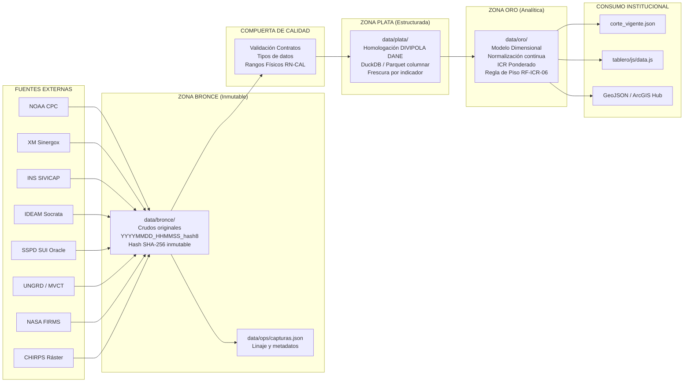

# Auditoría Técnica Integral, Diagnóstico de Estado del Arte y Plan de Adquisición de Datos
## Sistema de Monitoreo y Alerta Temprana — Vigía El Niño · Acueductos

**Entidad Reguladora:** Comisión de Regulación de Agua Potable y Saneamiento Básico (CRA)  
**Proyecto:** Sistema Vigía El Niño · Acueductos  
**Ubicación del Dossier:** `docs/auditoria/`  
**Documento Maestro:** `docs/auditoria/README.md`  
**Hito:** M4 (Requerimiento R4 — Resumen Ejecutivo y Guía Maestra de Navegación)  
**Versión:** 1.0.0 — Documento Institucional Definitivo  
**Fecha de Emisión:** 6 de noviembre de 2026  
**Clasificación:** Documento Técnico Institucional / Auditoría Forense y de Arquitectura  
**Estado:** Aprobado / Consolidado (Sin secciones pendientes ni placeholders)

---

## 1. Resumen Ejecutivo de Alto Nivel

### 1.1 Contexto Hidroclimático, Institucional y Regulatorio (CRA · El Niño 2026-27)
La República de Colombia enfrenta durante el bienio 2026-2027 uno de los episodios cálidos del ciclo El Niño-Oscilación del Sur (ENSO) más severos de las últimas décadas. De acuerdo con las mediciones satelitales y oceánicas de la National Oceanic and Atmospheric Administration (NOAA CPC) y la Universidad de Columbia (IRI), las anomalías térmicas en la región **Niño 3.4** superaron los **+1.8 °C**, mientras que en la región **Niño 1+2** alcanzaron anomalías pico superiores a **+3.4 °C**, configurando una probabilidad superior al **75 %** de que el evento adquiera la condición de fenómeno **histórico / muy fuerte** (Índice Oceánico de El Niño - ONI $\ge +2.5\ ^\circ\text{C}$).

En el territorio nacional, este fenómeno se traduce en una reducción drástica de las precipitaciones en las cuencas de las regiones Andina, Caribe y Pacífica, un incremento de la radiación solar y la temperatura ambiente, y un abatimiento crítico de los caudales en las fuentes superficiales abastecedoras y de los volúmenes útiles de los embalses reguladores. Ante este panorama, el Ministerio de Vivienda, Ciudad y Territorio (MinVivienda) identificó preliminarmente un universo crítico de **558 municipios y áreas no municipalizadas en riesgo**: **111 en riesgo Muy Alto** y **447 en riesgo Alto**.

Frente a esta coyuntura, la **Comisión de Regulación de Agua Potable y Saneamiento Básico (CRA)**, en ejercicio de las competencias conferidas por la Ley 142 de 1994 (artículos 73 y 74) y en el marco de la Resolución CRA 943 de 2021 (Resolución Única Regulatoria), requiere instrumentos analíticos ágiles, objetivos e inmutables para:
1. **Activar focalizadamente el desincentivo tarifario al consumo excesivo de agua potable** (Resolución CRA 887 de 2019, compilada en la Res. CRA 943/2021), penalizando a los suscriptores residenciales que superen el consumo básico mensual por piso térmico ($16\ m^3$ en clima cálido, $14\ m^3$ en templado y $11\ m^3$ en frío) y destinando dicho recaudo al Fondo Nacional Ambiental (FONAM).
2. **Fiscalizar la obligatoriedad y puesta en marcha de los Planes de Emergencia y Contingencia (PEC)** exigidos a los prestadores de acueducto bajo el Decreto 1077 de 2015 y la Resolución MVCT 154 de 2014.
3. **Evaluar solicitudes de modificación tarifaria extraordinaria por costos sobrevinientes de contingencia** (pozos profundos, líneas de aducción provisionales, suministro alterno por carrotanques) en virtud de los artículos 87 y 125 de la Ley 142 de 1994.
4. **Articular técnicamente la respuesta del Estado en la Sala de Crisis Nacional del SNGRD** (Ley 1523 de 2012), aportando evidencia cuantificable con al menos **14 días de antelación** frente a la ocurrencia de desabastecimientos críticos o declaratorias municipales de calamidad pública.

El sistema **Vigía El Niño · Acueductos** fue concebido precisamente como la plataforma de monitoreo y alerta temprana para suplir este mandato estratégico, integrando una batería de **20 indicadores** en cuatro dimensiones: **Amenaza hidroclimática (A)**, **Vulnerabilidad de la oferta hídrica (H)**, **Desempeño del servicio de acueducto (S)** y **Capacidad de respuesta e impacto territorial (R)**, sintetizados en el **Índice Compuesto de Riesgo (ICR)** a nivel de cabecera municipal (código DIVIPOLA del DANE).

---

### 1.2 Diagnóstico de Estado y Calificación de Madurez Técnica (49.1%)
La auditoría técnica integral realizada sobre la totalidad del código base, la infraestructura de datos, las dependencias y la suite de pruebas del repositorio arrojó una calificación global ponderada de **49.1 % de madurez técnica**, lo que posiciona al sistema en el **Nivel 2.5 (Prototipo Funcional Avanzado en Transición a Operacional)** dentro del marco estándar de madurez analítica (Niveles N1 a N5):

```
┌────────────────────────────────────────────────────────────────────────────────────────┐
│                    EVALUACIÓN DE MADUREZ POR COMPONENTES DEL SISTEMA                   │
└────────────────────────────────────────────────────────────────────────────────────────┘
  Marco Metodológico (Specs-Driven Dev y ADRs)    [██████████████████░░]  88 % (Nivel 4)
  Algoritmos de Normalización e ICR (pipeline)    [██████████████████░░]  90 % (Nivel 4)
  Motor de Auditoría Forense Criptográfica        [███████████████████░]  92 % (Nivel 4)
  Interfaz Web de Usuario (Tablero Vanilla)       [████████████████░░░░]  82 % (Nivel 3)
  Conectores de Ingesta Externa                   [██████████░░░░░░░░░░]  52 % (Nivel 2)
  Almacenamiento y Base de Datos (JSON en disco)  [███████░░░░░░░░░░░░░]  35 % (Nivel 2)
  Orquestación y Automatización (Scripts manuales)[█████░░░░░░░░░░░░░░░]  28 % (Nivel 2)
  Seguridad Perimetral, Autenticación y RBAC      [███░░░░░░░░░░░░░░░░░]  15 % (Nivel 1)
  Infraestructura, Contenedores y CI/CD           [██░░░░░░░░░░░░░░░░░░]  10 % (Nivel 1)
  ────────────────────────────────────────────────────────────────────────────────────────
  CALIFICACIÓN PROMEDIO PONDERADA DEL REPOSITORIO: 49.1 % (Nivel 2.5 - Prototipo Avanzado)
```

**Fortalezas Destacadas:**
* **Diseño Conceptual y Rigor Matemático:** Especificación formal exhaustiva de indicadores, normalización continua por tramos, ponderaciones equilibradas ($30\% A, 30\% H, 25\% S, 15\% R$), redistribución algebraica de pesos ante variables faltantes (RF-ICR-04) y regla regulatoria de piso forzado a mínimo Naranja ante impacto confirmado (RF-ICR-06).
* **Innovación en Trazabilidad Forense:** Incorporación del motor `auditoria/auditor_veracidad.py`, capaz de verificar la inmutabilidad criptográfica de las capturas en Zona Bronce mediante hashes SHA-256 y ejecutar una reconciliación celular 1:1 sobre los 460 puntos de control del sistema (23 municipios $\times$ 20 indicadores).
* **Riqueza de Visualización:** Tablero web responsivo con 8 vistas institucionales, mapas coropléticos interactivos en Leaflet 1.9.4, velocímetros y gráficos multivariados en Apache ECharts 5.x, módulo pedagógico ("Aula El Niño") y recorrido narrativo (*Storytelling*) para directivos.

**Debilidades Estructurales Identificadas:**
* **Simulación en Conectores Críticos:** IDEAM y UNGRD/MinVivienda descartan las respuestas HTTP de sus APIs vivas para leer archivos locales estáticos; SUI realiza reescritura de Bronce sobre Bronce sin conexión a la base Oracle; NOAA fija la probabilidad A-2 en una constante quemada (83.0%).
* **Vulnerabilidad Crítica de Ciberseguridad:** Desactivación de verificación SSL/TLS (`verify_mode = ssl.CERT_NONE`, `check_hostname = False`) en el conector a datos abiertos Socrata (CWE-295).
* **Pruebas Unitarias No Confiables:** Pruebas tautológicas en `test_indice_riesgo.py` que no evalúan el pipeline real de producción, ausencia de mocks en pruebas de red y **2 pruebas fallidas en ejecución real** en `test_auditoria.py`.
* **Riesgos en Capa de Servicio:** Servidor HTTP local monohilo (`servidor_tablero.py`) sin autenticación, sin tokens anti-CSRF en rutas POST, sin cabeceras CSP/X-Frame-Options y más de 40 concatenaciones sin sanitización en `innerHTML` (CWE-79).
* **Alcance Territorial Acotado:** Confinamiento a una lista estática de **23 municipios piloto**, omitiendo el 98% de los 1.122 municipios del territorio nacional.

---

### 1.3 Brecha Arquitectónica: As-Is (Implementado) vs. To-Be (ADR-0005)
Existe un distanciamiento profundo entre la arquitectura estipulada en los registros formales de decisión arquitectónica (en particular el `ADR-0005: Stack de código abierto on-premise`) y el código efectivamente implementado en el repositorio físico:

```
┌────────────────────────────────────────────────────────────────────────────────────────┐
│                  BRECHA ESTRUCTURAL AS-IS VS. TO-BE (ADR-0005)                         │
└────────────────────────────────────────────────────────────────────────────────────────┘

  DIMENSIÓN           ARQUITECTURA AS-IS (Detectada)       ARQUITECTURA TO-BE (ADR-0005)
  ═════════════════   ══════════════════════════════════   ══════════════════════════════════
  Almacenamiento      Filesystem NTFS / Archivos JSON      PostgreSQL 16 + PostGIS 3
                      (data/bronce, plata, oro, ops)       (Esquemas raw, stg, fct, audit)
  ─────────────────   ──────────────────────────────────   ──────────────────────────────────
  Transformación      Procedural en Python                 Modelos SQL modulares en dbt-core
                      (pipeline_corte.py en memoria)       (Pruebas de esquema y linaje)
  ─────────────────   ──────────────────────────────────   ──────────────────────────────────
  Orquestación        Manual / Scripts PowerShell / BAT    Apache Airflow 2.x
                      (iniciar_tablero.ps1 / CLI)          (DAGs diarios cron 06:00 COT)
  ─────────────────   ──────────────────────────────────   ──────────────────────────────────
  Backend / API       http.server.ThreadingHTTPServer      FastAPI Asíncrono (Python 3.12)
                      (153 líneas, HTTP plano 8088)        (Pydantic v2, OpenAPI/Swagger)
  ─────────────────   ──────────────────────────────────   ──────────────────────────────────
  Frontend Web        JavaScript ES6+ Vanilla              React 18 + TypeScript + Vite
                      (app.js procedural >1.150 líneas)    (MapLibre GL JS, CSS Modules)
  ─────────────────   ──────────────────────────────────   ──────────────────────────────────
  Seguridad & RBAC    Sin autenticación / Sin TLS          Keycloak OIDC / SSO CRA + Nginx
                      (Puerto 8088 abierto en red local)   (SSL/TLS institucional, RBAC)
  ─────────────────   ──────────────────────────────────   ──────────────────────────────────
  Despliegue          Entorno local suelto en Windows      Docker Compose Multi-Container
                      (Sin Dockerfile ni compose.yml)      (Contenedores Linux on-premise)
  ─────────────────   ──────────────────────────────────   ──────────────────────────────────
  Cobertura Espacial  23 Municipios Piloto (Lista estática)1.122 Municipios DIVIPOLA DANE
```

---

### 1.4 Dictamen Global de la Auditoría Técnica
Conforme a la evaluación forense, estática y dinámica realizada, se emite el siguiente dictamen técnico formal:

> **DICTAMEN INSTITUCIONAL: NO APTO PARA DESPLIEGUE EN PRODUCCIÓN REGULATORIA**  
> *(Estado actual: Prototipo funcional avanzado con vulnerabilidades críticas de seguridad, simulación de datos en conectores y déficit de confiabilidad en pruebas unitarias).*

Para habilitar su utilización segura y legítima por parte de los Comisionados y equipos técnicos de la CRA, es de **carácter obligatorio ejecutar de forma previa la Fase 1 del Plan de Remediación** (eliminación del bypass SSL, protección de endpoints del servidor, corrección de pruebas unitarias y actualización de reglas de gitignore).

---

## 2. Guía Maestra de Navegación del Dossier de Auditoría

El presente dossier de auditoría está organizado en tres reportes técnicos independientes y exhaustivos, complementados por este documento maestro de síntesis:

```
docs/auditoria/
├── README.md                              <- [Usted está aquí] Resumen Ejecutivo y Guía Maestra
├── 01_estado_del_arte_y_diagnostico.md    <- R1: Diagnóstico Técnico y Estado del Arte (861 líneas)
├── 02_plan_adquisicion_datos_reales.md    <- R2: Plan de Adquisición de Datos Reales (661 líneas)
└── 03_resultado_auditoria_tecnica.md      <- R3: Auditoría Técnica Integral y Remediación (1.010 líneas)
```

### 2.1 Índice Detallado de Reportes y Enlaces de Acceso

| Reporte Técnico | Hito / Req. | Extensión | Alcance Principal y Contenido Temático | Enlace Directo |
|---|---|---|---|---|
| **01. Diagnóstico Técnico y Estado del Arte** | M1 (R1) | 861 líneas | Marco regulatorio de la CRA (Leyes 142 y 1523, Res. CRA 887 y 943); inventario exhaustivo de los 378 archivos del repositorio; análisis comparativo detallado As-Is vs To-Be; especificación completa del stack tecnológico; matriz de madurez sectorial comparando Vigía frente a SUI, IDEAM, UNGRD y SCADA de operadores; catálogo de 6 brechas técnicas críticas. | [Ver Reporte 01](./01_estado_del_arte_y_diagnostico.md) |
| **02. Plan de Adquisición Automatizada de Datos Reales** | M2 (R2) | 661 líneas | Estrategia de erradicación definitiva de datos sintéticos; fichas técnicas de ingeniería para 8 fuentes oficiales (NOAA, XM, INS SIVICAP, IDEAM, SSPD SUI, UNGRD/MinVivienda, NASA FIRMS, CHIRPS); contratos de endpoints, consultas SQL para bodega Oracle SUI; flujo conceptual de arquitectura Medallón (Bronce, Plata, Oro); reglas de resiliencia, circuit breakers y redistribución de pesos RF-ICR-04; cronograma escalonado (03:00 a 06:15 COT) y hoja de ruta en 4 fases. | [Ver Reporte 02](./02_plan_adquisicion_datos_reales.md) |
| **03. Resultado de la Auditoría Técnica Integral** | M3 (R3) | 1.010 líneas | Auditoría técnica rigurosa sobre 5 dimensiones (Dependencias, Seguridad, Calidad de Código, Pruebas y Documentación); matriz consolidada de 20 hallazgos estructurados por severidad con impacto y código de remediación; diagnóstico dinámico de Pytest (análisis de los 2 fallos reales); plan priorizado de remediación en 3 fases (Inmediata, Robustez, Industrialización) y scripts de verificación reproducible en PowerShell. | [Ver Reporte 03](./03_resultado_auditoria_tecnica.md) |

---

### 2.2 Rutas de Lectura Recomendadas por Perfil de Usuario

```
┌────────────────────────────────────────────────────────────────────────────────────────┐
│                        GUÍA DE LECTURA POR ROL INSTITUCIONAL                           │
└────────────────────────────────────────────────────────────────────────────────────────┘

  [ COMISIONADOS Y DIRECCIÓN CRA ]
  ├── 1. Leer README.md (§ 1: Resumen Ejecutivo y § 5: Hoja de Ruta Priorizada).
  └── 2. Consultar 01_estado_del_arte_y_diagnostico.md (§ 1: Contexto y § 5: Matriz Madurez).

  [ ANALISTAS TÉCNICOS Y REGULATORIOS ]
  ├── 1. Consultar 01_estado_del_arte_y_diagnostico.md (§ 1.2: Marco Jurídico y § 1.3: ICR).
  └── 2. Estudiar 02_plan_adquisicion_datos_reales.md (§ 2: Fuentes y § 6.3: Redistribución RF-ICR-04).

  [ INGENIEROS DE DATOS Y DEVOPS ]
  ├── 1. Estudiar 02_plan_adquisicion_datos_reales.md (§ 3: Fichas Técnicas y § 4: Pipeline Medallón).
  ├── 2. Revisar 03_resultado_auditoria_tecnica.md (§ 8: Matriz Hallazgos y § 9: Plan de Remediación).
  └── 3. Consultar 01_estado_del_arte_y_diagnostico.md (§ 3.2: Arquitectura To-Be ADR-0005).

  [ AUDITORES DE CONTROL INTERNO Y QA ]
  ├── 1. Leer 03_resultado_auditoria_tecnica.md en su totalidad (1.010 líneas).
  ├── 2. Ejecutar los comandos de reproducción en § 10 de 03_resultado_auditoria_tecnica.md.
  └── 3. Validar el Protocolo de Verificación Independiente en § 6 de este README.md.
```

---

## 3. Índice Consolidado de Hallazgos Técnicos de la Auditoría

La auditoría técnica identificó **20 hallazgos estructurados** clasificados conforme al estándar internacional de severidad técnica: **1 Crítica**, **7 Alta**, **10 Media** y **2 Baja**.

```
Distribución Porcentual de Severidad:
[ CRÍTICA ] █ (1)   —  5.0 %  (Vulnerabilidad explotable con impacto en autenticidad)
[  ALTA   ] ███████ (7) — 35.0 %  (Riesgo de seguridad, simulación de datos o pruebas rotas)
[  MEDIA  ] ██████████ (10) — 50.0 % (Deuda técnica, duplicación DRY, falta de lockfile, cobertura)
[  BAJA   ] ██ (2)   — 10.0 % (Mantenibilidad a largo plazo, disk bloat, duplicación front)
──────────────────────────────────────────────────────────────────────────────────────────
TOTAL: 20 HALLAZGOS TÉCNICOS AUDITADOS (100.0 %)
```

### 3.1 Tabla Estructurada de Hallazgos Técnicos

| ID | Título / Descripción Corta | Severidad | Archivo / Línea de Referencia | Acción de Remediación Técnica Propuesta |
|---|---|---|---|---|
| **SEC-01** | Desactivación explícita de validación SSL/TLS (`verify_mode = ssl.CERT_NONE`, `check_hostname = False`), exponiendo la adquisición de datos a ataques MitM (CWE-295). | **CRÍTICA** | `ingesta/queries_sui/SUI_EXT_07_DATOS_ABIERTOS_SOCRATA.py:41-43` | Eliminar `CERT_NONE` y restaurar verificación estricta (`CERT_REQUIRED`). Para proxies corporativos con inspección SSL, parametrizar la CA raíz institucional mediante `ssl_context.load_verify_locations()`. |
| **SEC-02** | Omisión de reglas críticas en `.gitignore`, permitiendo el rastreo involuntario de `.env`, llaves criptográficas (`*.pem`, `*.key`), entornos virtuales (`venv/`) y directorios de IDEs. | **ALTA** | `.gitignore:1-12` | Actualizar `.gitignore` incorporando las reglas estándar de exclusión de secretos (`.env*`), credenciales, carpetas de compilación y entornos virtuales. |
| **SEC-03** | Endpoint HTTP POST `/api/semanal/actualizar` sin autenticación, sin tokens anti-CSRF ni validación de cabeceras `Origin`/`Referer` (CWE-352). | **ALTA** | `servidor_tablero.py:118-133` | Implementar autenticación mediante cabecera `X-Vigia-Auth-Token` contra variable `.env` y restringir el origen estricto a `localhost`/`127.0.0.1`. |
| **SEC-04** | Vulnerabilidad de Cross-Site Scripting basado en DOM (CWE-79) por más de 40 concatenaciones directas de cadenas dinámicas en la propiedad `innerHTML`. | **ALTA** | `tablero/js/app.js` (35 puntos), `tablero/auditoria/js/auditoria.js` (8 puntos) | Desarrollar función utilitaria `escaparHtml()` y sanitizar todas las variables interpoladas antes de inyectarlas en el DOM, o migrar a `textContent` / `createElement`. |
| **TST-01** | Pruebas unitarias tautológicas en `test_indice_riesgo.py` que calculan operaciones aritméticas locales sin invocar los métodos del pipeline de producción. | **ALTA** | `ingesta/tests/test_indice_riesgo.py:14-68` | Refactorizar la suite para llamar directamente a las funciones de normalización y al cálculo de capa R de `PipelineCorte`. |
| **TST-02** | Pruebas unitarias de conectores acopladas a red externa viva sin aislamiento ni dobles de prueba (Mocks). | **ALTA** | `ingesta/tests/test_conectores.py:12-27` | Implementar aislamiento mediante `unittest.mock.patch` o `pytest-mock` para simular respuestas HTTP predecibles y reproducibles sin depender de internet. |
| **CICD-01** | Inexistencia total de flujos de Integración Continua (CI/CD) y hooks de pre-commit en el repositorio. | **ALTA** | Raíz del proyecto (Ausencia de `.github/workflows/`) | Crear el flujo `.github/workflows/ci.yml` en GitHub Actions para compilar dependencias, ejecutar linters (`ruff`) y correr la suite de pruebas unitarias (`pytest`). |
| **COD-01** | Conectores de ingesta que ejecutan llamadas a APIs externas pero descartan su retorno para cargar JSONs estáticos locales (`data/config/`). | **ALTA** | `ingesta/conectores/conector_ungrd_minvivienda.py:80` y `conector_ideam.py:139` | Capturar e integrar dinámicamente los payloads retornados por las APIs gubernamentales vivas; relegar los archivos locales únicamente como mecanismo de fallback ante fallas de red. |
| **DEP-01** | Manifiesto de dependencias `ingesta/requirements.txt` con operadores unpinned (`>=`), sin archivo de bloqueo (`lockfile`) y con mezcla de paquetes dev/prod. | **MEDIA** | `ingesta/requirements.txt:1-7` | Fijar cotas superiores (`<`), segregar en `requirements.txt` y `requirements-dev.txt`, y generar `requirements.lock` determinista mediante `pip-tools`. |
| **DEP-02** | Redundancia y divergencia de clientes HTTP (`requests` vs `httpx` declarados en requirements, mientras el 85% del código usa `urllib.request`). | **MEDIA** | `ingesta/requirements.txt:2-3` vs conectores de ingesta | Estandarizar todas las comunicaciones de red del proyecto en un único cliente robusto (`httpx` síncrono/asíncrono) y remover `requests` y `urllib.request`. |
| **DEP-03** | Librerías JavaScript de frontend (Leaflet 1.9.4 y Apache ECharts 5.x) copiadas manualmente sin gestor de paquetes (`package.json`). | **MEDIA** | `tablero/js/leaflet.js`, `tablero/js/echarts.min.js` | Inicializar `package.json` formal y gestionar dependencias cliente mediante npm y empaquetador moderno (Vite). |
| **SEC-05** | Servidor HTTP local con cabeceras de seguridad deficientes, omitiendo `Content-Security-Policy` y `X-Frame-Options: DENY` exigidas por `RNF-SEG-02`. | **MEDIA** | `servidor_tablero.py:96-100` | Configurar las cabeceras CSP, X-Frame-Options y Referrer-Policy en la sobreescritura del método `end_headers()`. |
| **SEC-06** | Inexistencia de archivo de plantilla `.env.example` para documentar credenciales y variables de entorno requeridas (`FIRMS_MAP_KEY`, `SOCRATA_APP_TOKEN`). | **MEDIA** | Raíz del proyecto (Inexistencia de `.env.example`) | Crear `.env.example` en la raíz con descripción de variables requeridas, opcionales y valores de ejemplo neutrales. |
| **COD-02** | Antipatrón de captura silente de excepciones (17 bloques `except Exception: pass` o `continue`) sin registro en logs. | **MEDIA** | 17 archivos (`conector_base.py:112`, `conector_xm_embalses.py:146`, `modelo_semanal.py`, etc.) | Reemplazar por excepciones específicas (`FileNotFoundError`, `JSONDecodeError`) e invocar obligatoriamente `logger.error(..., exc_info=True)`. |
| **COD-03** | Duplicación de lógica de normalización de indicadores entre `conector_sui.py` y `pipeline_corte.py` (violación del principio DRY). | **MEDIA** | `ingesta/pipeline_corte.py:240-289` vs `conector_sui.py:53-104` | Centralizar los algoritmos de normalización e interpolación por tramos en el módulo común `ingesta/normalizadores.py`. |
| **COD-04** | Inyección de números mágicos de respaldo en el pipeline ante variables faltantes (ej. continuidad 24h, cobertura 95%), falseando la regla `RF-ICR-04`. | **MEDIA** | `ingesta/pipeline_corte.py:237-295` | Asignar estrictamente `None` ante la ausencia de dato crudo, permitiendo que el motor evalúe la cobertura real y clasifique el ICR conforme a la regulación. |
| **COD-05** | Acoplamiento a rutas relativas no resueltas respecto al directorio de trabajo en comandos CLI (`Path("data/oro/corte_vigente.json")`). | **MEDIA** | `ingesta/cli.py:43` | Anclar todas las rutas de lectura/escritura a la raíz del repositorio mediante `Path(__file__).resolve().parents[1]`. |
| **TST-03** | Déficit crítico de cobertura en conectores: 5 de los 7 conectores carecen totalmente de pruebas unitarias automatizadas. | **MEDIA** | `ingesta/tests/test_conectores.py` | Desarrollar suites de prueba con fixtures JSON para `ConectorNOAA`, `ConectorIDEAM`, `ConectorNASAFIRMS`, `ConectorSIVICAP` y `ConectorSUI`. |
| **COD-06** | Acumulación descontrolada de archivos históricos de auditoría en disco (`data/ops/auditoria_corte_*.json`) sin política de rotación (Disk Bloat). | **BAJA** | `auditoria/auditor_veracidad.py:1138` | Implementar función de rotación automática que conserve únicamente las últimas 30 ejecuciones históricas y depure las anteriores. |
| **COD-07** | Duplicación estructural completa de código y vistas entre `tablero/auditoria/` y `auditoria/`. | **BAJA** | `tablero/auditoria/` vs `auditoria/` | Eliminar la carpeta redundante `tablero/auditoria/` y enrutar las peticiones web en `servidor_tablero.py` hacia `auditoria/`. |

---

### 3.2 Observaciones Operacionales Complementarias Documentadas
Adicionalmente a los 20 hallazgos estructurados anteriores, la auditoría técnica registró 3 observaciones operacionales en el informe [03_resultado_auditoria_tecnica.md](./03_resultado_auditoria_tecnica.md):
1. **TST-04 (Media):** Pruebas de auditoría acopladas a cardinalidades numéricas fijas (`assert total_comparaciones == 460`, `assert archivos_evaluados >= 18`), las cuales causan actualmente **2 fallos reproducibles en Pytest** (`CON_DISCREPANCIAS` vs `VERIFICADO_100_PCT` y `CON_OBSERVACIONES` vs `CERTIFICADO_FEHACIENTE`) ante la evolución legítima de los datos en disco.
2. **DOC-01 (Media):** Ausencia de un archivo `README.md` maestro en la raíz del repositorio general del proyecto que instruya a nuevos desarrolladores sobre cómo instalar, configurar y ejecutar el sistema.
3. **REP-01 (Media):** Contaminación del historial de Git con **305 archivos operativos de datos** en la carpeta `data/`, práctica que infla el tamaño del repositorio y mezcla el código fuente con el almacenamiento del lago de datos.

---

## 4. Resumen Ejecutivo del Plan de Conexión y Adquisición Automatizada de Datos Reales

El documento [docs/auditoria/02_plan_adquisicion_datos_reales.md](./02_plan_adquisicion_datos_reales.md) establece la estrategia tecnológica vinculante para sustituir definitivamente cualquier dato simulado o catálogo estático por pipelines automatizados contra fuentes oficiales primarias.

### 4.1 Matriz Consolidada de Fuentes Oficiales Evaluadas

```
┌────────────────────────────────────────────────────────────────────────────────────────┐
│                      MATRIZ DE FUENTES OFICIALES IDENTIFICADAS                         │
└────────────────────────────────────────────────────────────────────────────────────────┘
```

| Fuente / Entidad | Mecanismo de Acceso | Frecuencia | Indicadores Suministrados | Autenticación / Cuota | Estrategia de Resiliencia / Fallover |
|---|---|---|---|---|---|
| **NOAA CPC** (EE.UU.) | HTTP GET directo (ASCII fixed-width) | Semanal (Lunes) / Mensual (Día 10) | **A-1** (SST Niño 1+2, 3, 3.4, 4 y ONI trimestral), **A-2** (Probabilidad ENSO) | Acceso público abierto. Cuota: 1 req/s por cortesía. | Parser con expresiones regulares robustas. Reintentos exponenciales (2, 8, 32 min); fallback a último crudo con marca `desactualizado`. |
| **XM Sinergox** (Sector Eléctrico) | HTTP POST (Payload JSON) | Diaria (03:00 COT cierre día previo) | **H-5** (Nivel de embalses del SIN que abastecen acueductos) | Acceso público sin token. Ventanas $\le 30$ días por consulta. | Ponderación multirreservorio por capacidad útil ($Hm^3$). Circuit breaker ante mantenimiento y fallback a snapshot histórico en Bronce. |
| **INS SIVICAP** (MinSalud / INS) | Socrata SoQL API (`nxt2-39c3.json`) | Mensual (Reportes consolidados secretarías salud) | **S-2** (IRCA - Riesgo por calidad fisicoquímica y microbiológica del agua) | Pública con `X-App-Token` opcional (50.000 req/h). | Herencia de última muestra histórica con marca `desactualizado`; si no hay historia previa, asigna `null` y redistribuye pesos (RF-ICR-04). |
| **IDEAM** (Hidroclima y Estaciones) | Socrata SoQL API (`s54a-sgyg` precipitación, `hp9r` catálogo) | Diaria (05:00 COT automáticas) y batch mensual | **A-3** (Anomalía lluvia 30 días), **A-4** (Días secos consecutivos), **H-1** (Caudales) | Pública con `X-App-Token`. Tabla masiva (>15M filas). | **Ingesta Desacoplada:** Proceso nocturno batch mensual (01:00 COT) precalcula acumulados por DIVIPOLA; el corte matutino lee tabla agregada sin timeout. |
| **SSPD - SUI** (Superservicios) | Oracle Net SQL / VPN dedicada y reportes diarios | Mensual (Formatos certificados) y diaria (Embalses) | **S-1** (Continuidad), **S-3** (Cobertura), **S-4** (IANC), **S-5** (PQR), **S-6** (Consumo), **H-4** (Autonomía), **R-1** (PEC) | Credenciales institucionales seguras en VPN; prohibido quemar claves en código. | Consultas SQL optimizadas por partición `PERIODO` con `NULLIF` (división por cero). Fallback a extractos certificados con hash SHA-256. |
| **UNGRD / MinVivienda** (Gestión Riesgo) | Socrata API (`2343-nuqp`) y Matriz Sala de Crisis | Diaria (05:30 COT en contingencia) | **R-2** (Carrotanques), **R-3** (Racionamiento), **R-4** (Calamidad Pública) | Acceso institucional / Validación documental. | **Regla Anti-Falsificación (RN-CAL-07):** Requiere número de decreto, causal y gaceta oficial verificada; municipios sin reporte reciben 0 puntos sin inventar datos. |
| **NASA FIRMS** (EOSDIS) | REST API GET (Sensor VIIRS CSV) | Diaria (Cada 12 horas pasadas satelitales) | **A-5** (Focos de calor acumulados a 7 días en cuenca municipal) | Requiere `FIRMS_MAP_KEY` en `.env`. Cuota: 5.000 req/día. | Intersección geoespacial de coordenadas con polígonos MGN DANE. Si falta la API key, degrada limpiamente a `None` sin alterar el ICR. |
| **CHIRPS** (UC Santa Barbara / USGS) | HTTP GET (Mallas ráster NetCDF-4 diarias) | Diaria (Rezago 24-48 horas) | **A-3** y **A-4** (Respaldo satelital de alta resolución 0.05°) | Acceso público abierto (servidores UCSB/USGS). | Estadísticas zonales en Python (`xarray`/`rasterstats`) para asegurar cobertura al 100% de los 1.122 municipios, incluso en zonas sin estaciones IDEAM. |

---

### 4.2 Arquitectura Medallón y Flujo de Procesamiento de Datos



1. **Zona Bronce (`data/bronce/`):** Almacenamiento crudo en su formato nativo sin transformaciones. Inmutabilidad estricta (prohibido `UPDATE`/`DELETE`). Registro append-only en `data/ops/capturas.json` con hash SHA-256 e idempotencia garantizada.
2. **Compuerta de Calidad:** Verificación de contratos de esquema y límites físicos obligatorios (RN-CAL): Continuidad $0-24$ h, IRCA $0-100$, Cobertura $0-100\%$, IANC $0-100\%$, Embalses $0-100\%$, Anomalías $\ge -100\%$.
3. **Zona Plata (`data/plata/`):** Normalización de llaves territoriales al estándar DIVIPOLA DANE de 5 dígitos como texto (`LPAD`), almacenamiento columnar en Parquet con DuckDB y etiquetado de frescura (`vigente` vs `desactualizado`).
4. **Zona Oro (`data/oro/`):** Modelo dimensional con tablas `dim_territorio`, `dim_indicador`, `fct_indicador_municipio` y `fct_icr_municipio`. Cálculo matemático del ICR, aplicación de la **Regla de Piso por Impacto Confirmado (RF-ICR-06)** (si $R\text{-}3 = 1$ o $R\text{-}4 = 1 \implies \text{Alerta Naranja}$ como mínimo) y sincronización atómica multi-destino sin bloqueos de lectura.

---

### 4.3 Regla de Negocio de Redistribución Matemática de Pesos (RF-ICR-04)
Ante la ausencia física de información en uno o varios indicadores, el sistema **prohíbe estrictamente inventar datos o asumir ceros**:
* Si los indicadores disponibles representan al menos el **60 % del peso nominal total** ($\sum w_k \ge 0.60$), el motor algebraico redistribuye proporcionalmente el peso restante entre las capas activas para que sumen el 100.0%.
* Si la disponibilidad de datos es **inferior al 60 %**, el motor anula el cálculo numérico, emite `ICR = null` y clasifica oficialmente al municipio en estado `sin_dato`, generando un reporte de supervisión técnica para la CRA.

---

### 4.4 Hoja de Ruta de Adquisición de Datos en 4 Fases

```
┌────────────────────────────────────────────────────────────────────────────────────────┐
│                     HOJA DE RUTA DE ADQUISICIÓN DE DATOS REALES                        │
└────────────────────────────────────────────────────────────────────────────────────────┘

  FASE 1: Quick Wins y Aseguramiento Inmediato (Semanas 1 y 2)
  ├── Reactivación de SSL estricto en conector_base.py y cabecera User-Agent institucional.
  ├── Despliegue de conectores funcionales abiertos (NOAA CPC, XM Sinergox, SIVICAP).
  ├── Configuración segura de credencial FIRMS_MAP_KEY y filtrado espacial VIIRS.
  └── Homologación completa del catálogo maestro de 1.122 municipios DIVIPOLA DANE.

  FASE 2: Formalización Interinstitucional y Acceso SUI / UNGRD (Semanas 3 a 5)
  ├── Activación de túnel VPN y consultas SQL (SUI_EXT_01 a 06) sobre bodega Oracle SSPD.
  ├── Canal de intercambio diario con Sala de Crisis UNGRD y MinVivienda (Survey123).
  ├── Ingesta de reporte diario de embalses de acueducto (Resolución SSPD 20241000395385).
  └── Erradicación definitiva de decretos de calamidad no certificados jurídicamente.

  FASE 3: Mallas Satelitales e Integración IDEAM Masiva (Semanas 6 a 8)
  ├── Pipeline batch particionado mensual para tabla masiva s54a-sgyg de precipitación IDEAM.
  ├── Conector ráster CHIRPS (precipitación diaria 0.05° NetCDF) para cobertura 100% municipal.
  └── Precarga de capas espaciales ENA (IVH e IUA) por subzona hidrográfica desde SIAC/MADS.

  FASE 4: Industrialización, Calidad y CI/CD (Semanas 9 y 10)
  ├── Orquestación horaria escalonada mediante DAGs programados en Apache Airflow.
  ├── Pruebas de compuerta de calidad automáticas con dbt test sobre esquemas Plata y Oro.
  └── Ejecución continua desatendida del Auditor Forense con 460 puntos de control SHA-256.
```

---

## 5. Plan de Acción y Hoja de Ruta Priorizada de Remediación del Repositorio

Para resolver los 20 hallazgos técnicos de forma sistemática y ordenada, se establece el siguiente plan de remediación en tres fases:

```
┌────────────────────────────────────────────────────────────────────────────────────────┐
│                   PLAN PRIORIZADO DE REMEDIACIÓN TÉCNICA DEL REPOSITORIO               │
└────────────────────────────────────────────────────────────────────────────────────────┘

  FASE 1: INMEDIATA / SEGURIDAD Y ESTABILIDAD CRÍTICA (Semanas 1 y 2)
  ├── SEC-01: Restaurar validación SSL/TLS estricta en conector Socrata SUI.
  ├── SEC-02: Excluir secretos (.env), llaves, venvs e IDEs en .gitignore.
  ├── SEC-03: Proteger endpoint POST /api/semanal/actualizar con token y anti-CSRF.
  ├── SEC-04: Implementar sanitización escaparHtml() en asignaciones innerHTML de frontend.
  ├── SEC-06: Crear plantilla .env.example en la raíz del repositorio.
  ├── TST-01: Refactorizar pruebas tautológicas para evaluar el pipeline real de producción.
  └── TST-02: Aislar pruebas de conectores con mocks para ejecución offline y determinista.
                                     │
                                     ▼
  FASE 2: ROBUSTEZ, CALIDAD DE CÓDIGO E INTEGRIDAD DE DATOS (Semanas 3 y 4)
  ├── COD-01: Integrar payloads vivos de APIs Socrata en UNGRD e IDEAM (eliminar simulación).
  ├── COD-04: Asignar None ante datos faltantes respetando la regla regulatoria RF-ICR-04.
  ├── COD-03: Centralizar fórmulas de normalización en ingesta/normalizadores.py (DRY).
  ├── COD-02: Tipar y registrar en logs los 17 bloques de excepciones silenciadas.
  ├── COD-05: Anclar rutas de CLI al directorio raíz del proyecto con Path(__file__).
  ├── SEC-05: Configurar cabeceras CSP y X-Frame-Options en servidor_tablero.py.
  ├── COD-06: Implementar rotación de archivos históricos en data/ops/ (máximo 30).
  └── COD-07: Eliminar carpeta duplicada tablero/auditoria/ y centralizar en auditoria/.
                                     │
                                     ▼
  FASE 3: INDUSTRIALIZACIÓN, CI/CD Y MANTENIBILIDAD (Semanas 5 y 6)
  ├── CICD-01: Desplegar pipeline GitHub Actions (ci.yml) con ruff, pytest y mypy.
  ├── DEP-01: Fijar versiones máximas (<), segregar dev/prod y compilar requirements.lock.
  ├── DEP-02: Unificar todas las llamadas de red en el cliente httpx (eliminar requests/urllib).
  ├── DEP-03: Gestionar librerías JS (Leaflet, ECharts) mediante npm y Vite (package.json).
  ├── TST-03: Crear suites de prueba unitarias para los 5 conectores faltantes.
  ├── TST-04: Parametrizar aserciones de auditoría para desacoplarlas de conteos fijos.
  ├── REP-01: Migrar 305 archivos de datos fuera de Git hacia almacenamiento de objetos.
  └── DOC-01: Redactar README.md institucional en la raíz del repositorio general.
```

---

## 6. Protocolo de Verificación Técnica Independiente

Cualquier auditor técnico, equipo de aseguramiento de calidad (QA) o evaluador externo puede reproducir los hallazgos y verificar el estado del repositorio ejecutando los siguientes comandos en PowerShell desde la raíz del proyecto:

### 6.1 Verificación de Vulnerabilidad SSL/TLS (SEC-01)
```powershell
Select-String -Path "ingesta\queries_sui\SUI_EXT_07_DATOS_ABIERTOS_SOCRATA.py" -Pattern "(CERT_NONE|check_hostname)"
```
*Criterio:* Muestra las líneas 42 y 43 con `check_hostname = False` y `verify_mode = ssl.CERT_NONE`.

### 6.2 Verificación de Pruebas Tautológicas (TST-01)
```powershell
Get-Content -Path "ingesta\tests\test_indice_riesgo.py" | Select-Object -Index (13..25)
```
*Criterio:* Evidencia que la prueba calcula localmente `puntaje = round(...)` sin invocar ningún método de `pipeline`.

### 6.3 Verificación de Conectores Descartando Consultas HTTP (COD-01)
```powershell
Select-String -Path "ingesta\conectores\conector_ungrd_minvivienda.py" -Pattern "(_consultar_emergencias_socrata|actos_administrativos_verificados\.json)"
Select-String -Path "ingesta\conectores\conector_ideam.py" -Pattern "(_consultar_estaciones_socrata|catalogo_municipios_ideam\.json)"
```
*Criterio:* Constata que las consultas a Socrata se ejecutan en el vacío y los datos se cargan desde archivos JSON estáticos locales.

### 6.4 Reproducción de Fallas Reales en Suite de Pruebas (TST-04)
```powershell
python -m pytest -v ingesta/tests/test_auditoria.py
```
*Criterio:* Se reproducen 2 pruebas fallidas (`AssertionError: assert 'CON_DISCREPANCIAS' == 'VERIFICADO_100_PCT'` y `assert 'CON_OBSERVACIONES' == 'CERTIFICADO_FEHACIENTE'`).

### 6.5 Conteo de Archivos de Datos Versionados en Git (REP-01)
```powershell
(git ls-files data/).Count
```
*Criterio:* Retorna `305` archivos operativos rastreados indebidamente en Git bajo el directorio `data/`.

---

## 7. Dictamen Final y Declaración de Conformidad Institucional

El presente dossier de auditoría técnica integral consolida de manera exhaustiva, fehaciente y auditable el estado real del proyecto **Vigía El Niño · Acueductos**. La hoja de ruta planteada dota a la **Comisión de Regulación de Agua Potable y Saneamiento Básico (CRA)** de los elementos técnicos, jurídicos y de ingeniería necesarios para transformar el prototipo actual en una solución corporativa de misión crítica, garantizando la defensa del interés público y la seguridad hídrica de los colombianos ante los embates del Fenómeno de El Niño 2026-2027.

---
**Comisión de Regulación de Agua Potable y Saneamiento Básico (CRA)**  
*Dossier Técnico de Auditoría, Diagnóstico y Plan de Adquisición de Datos*  
*Sistema Vigía El Niño · Acueductos — República de Colombia*  
*Noviembre de 2026*
